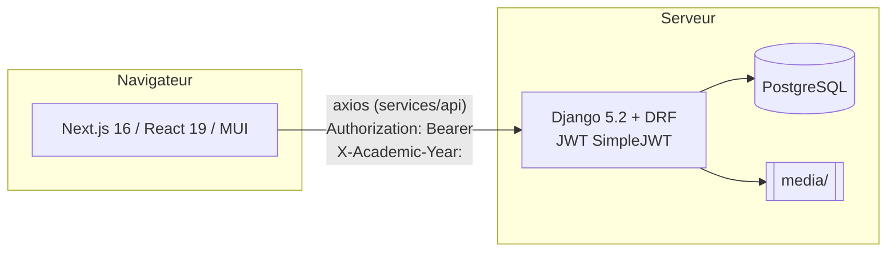

# Architecture

## Vue d'ensemble

| Couche | Technologies | Dossier |
|---|---|---|
| API | Django 5.2, Django REST Framework, SimpleJWT, django-filter, drf-spectacular | `back-istc/` |
| Interface | Next.js 16 (App Router), React 19, MUI 5, axios, react-hook-form + yup, recharts, jsPDF, xlsx | `frontend/` |
| Base | PostgreSQL (prod), SQLite (dev/tests) | — |
| Docs | MkDocs Material | `docs/`, `mkdocs.yml` |

## Cycle d'une requête API

1. Le frontend appelle `apiRequest()` (`frontend/src/services/api/client.js`). L'intercepteur ajoute :
    - `Authorization: Bearer <access>` (jeton stocké dans `localStorage.token`) ;
    - `X-Academic-Year: <id>` (année choisie dans le sélecteur, `localStorage.selectedAcademicYearId`).
2. Côté Django, les middlewares s'exécutent dans cet ordre (voir `MIDDLEWARE` dans `smart_back/settings.py`) :
    1. `CorsMiddleware` ;
    2. … middlewares Django standards …
    3. `academique.middleware.ArchiveAcademicYearMiddleware` : refuse (403) l'accès à une année **non active** aux non-superusers ;
    4. `users.middleware.PortalAccessMiddleware` : pour les comptes `etudiant` / `formateur`, n'autorise que les routes listées dans `PORTAL_RULES` ;
    5. `academique.middleware.AcademicYearMiddleware` : stocke l'année demandée dans un `ContextVar`, lisible partout via `get_current_academic_year_id()`.
3. La vue DRF applique `IsAuthenticated` (par défaut) puis ses propres contrôles de rôle (`users.permissions`).
4. En cas de 401, l'intercepteur tente un rafraîchissement (`/api/auth/token/refresh/`) puis rejoue la requête ; en cas d'échec, `clearSession()` et retour à `/login`.

## L'année académique, colonne vertébrale des données

- `AnneeAcademique` (`academique`) : une seule `est_active=True` (garanti dans `save()`).
- Créer une année recopie les `Classe` de l'année source (signal `academique/signals.py`).
- Les données annuelles (inscriptions, notes, emplois du temps, paiements) sont filtrées par l'année de l'en-tête `X-Academic-Year`, ou par l'année active à défaut.
- Créer une `Specialite` / un `Cycle` / un `Niveau` génère automatiquement les classes correspondantes pour chaque année (signaux).

## Calculs métier centralisés

| Sujet | Fonction / lieu | Remarque |
|---|---|---|
| Situation financière d'un étudiant | `paiements/finance.py::situation_financiere(etudiant, year_id)` | **Unique source** pour le suivi, le portail et le tableau de bord. Les frais dont le libellé contient « inscription » sont des frais d'inscription. |
| Note finale | `notes/models.py::Note.save()` | CC + SN (ou rattrapage), sur 100 ; bornes = `ParametresGlobaux`. |
| Heures vacataires | `vacations/models.py` (`arrondir_quart_heure`, `RecapMensuel.recalculer`) et `vacations/services.py` | Heures arrondies au ¼ h ; seul un récap `valide` est payé. |
| Paie | `paie/views.py` (`generer`, `valider`, `payer`) | `payer` crée les `Depense`, rembourse les avances, passe les récaps à `paye`. |
| Congés | `conges/models.py::Conge.save()` | Débit / crédit du solde transactionnel, jours ouvrés. |
| Créneaux | `emploidutemps/models.py::EmploiDuTemps.clean()` | **Seule** source des règles (pause, journée, conflits) ; le serializer l'appelle. |

!!! tip "Règle d'or"
    Une règle métier vit à **un seul endroit** (modèle ou service) et les vues / serializers l'appellent. Ne la recopiez pas dans le frontend autrement que comme aide à la saisie.

## Frontend

- **Routage** (`src/app`) en trois groupes :
    - `(dashboard)` pour l'administration ;
    - `(formateur-portal)` pour le portail formateur ;
    - `(portal)` pour le portail étudiant ;
    - plus les pages publiques `login` et `preinscription`.
- **Garde** :
    - `src/middleware.js` redirige les routes protégées sans session ;
    - `components/layout/PortalGuard.js` envoie chaque type de compte vers son espace.
- **Menus** : `src/config/routes.js` ; le filtrage par droits se fait dans `components/layout/Sidebar.js` (via `utils/permissions.js`).
- **Appels API** : uniquement via `src/services/api/services.js` (objets `xxxService`) et `endpoints.js`. Pas d'URL en dur dans les pages.
- **État global** : `context/AcademicYearContext.js` (année sélectionnée), `context/SidebarContext.js`.
