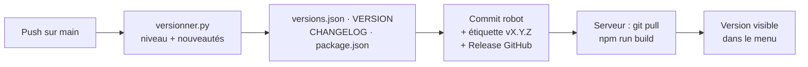

# Versions et livraisons

SmartCampus suit une numérotation **X.Y.Z** :

| Partie | Augmente quand… | Exemple |
|---|---|---|
| **X** (majeure) | un changement important ou incompatible (refonte, migration de données lourde) | 1.4.2 → **2.0.0** |
| **Y** (mineure) | de nouvelles fonctions | 1.4.2 → 1.**5**.0 |
| **Z** (correctif) | uniquement des corrections | 1.4.2 → 1.4.**3** |

La version actuelle s'affiche en bas du menu latéral, dans l'administration et dans les deux portails. Un clic ouvre la fenêtre **Nouveautés**, qui contient l'historique de toutes les versions. Une pastille orange signale à l'utilisateur une version qu'il n'a pas encore consultée.

## Une nouvelle version à chaque push sur `main`

Le workflow GitHub `.github/workflows/version.yml` s'exécute à chaque push sur `main` :

1. `outils/version/versionner.py` lit les commits poussés.
2. Le niveau est choisi dans cet ordre :
    1. la ligne `Niveau :` de `NOUVEAUTES.md` (si elle vaut `mineure` ou `majeure`) ;
    2. sinon un marqueur dans un message de commit : `[majeure]`, `[mineure]` ;
    3. sinon **correctif**.
3. Les nouveautés affichées aux utilisateurs sont les lignes `- …` de `NOUVEAUTES.md`. À défaut, ce sont les messages de commit d'au moins trois mots. Les messages vides de sens (« commit », « new changes ») sont écartés.
4. Les fichiers suivants sont mis à jour :
    - `frontend/src/config/versions.json` : historique lu par l'application ;
    - `VERSION` : lu par l'API (`settings.APP_VERSION`, version du schéma OpenAPI) ;
    - `CHANGELOG.md` ;
    - le champ `version` de `frontend/package.json` et de `package-lock.json`.
5. `NOUVEAUTES.md` est remis à zéro.
6. Le robot crée le commit `chore(version): vX.Y.Z [skip ci]` et l'étiquette `vX.Y.Z`, publie une **Release** GitHub avec les nouveautés, puis pousse le tout.



!!! info "La version apparaît à l'écran après le déploiement"
    Le numéro est intégré à l'interface au moment du `npm run build`. Après chaque push, faites `git pull` (pour récupérer le commit du robot) avant de construire, sur le serveur comme sur votre poste.

## Écrire les nouveautés d'une livraison

Les messages de commit sont rarement lisibles par un utilisateur. Le plus simple est de remplir `NOUVEAUTES.md` au fil du développement :

```markdown
Niveau : mineure

- Les reçus de paiement peuvent être téléchargés en PDF.
- Correction du calcul du solde des congés sur les jours fériés.
```

Écrivez pour l'utilisateur final, une phrase par nouveauté, avec les noms des menus et des boutons tels qu'ils apparaissent à l'écran.

## Cas particuliers

| Besoin | Comment faire |
|---|---|
| Pousser sans créer de version (faute de frappe dans la doc…) | Mettre `[sans version]` dans le message de commit, avec `NOUVEAUTES.md` vide |
| Forcer une version majeure | `Niveau : majeure` dans `NOUVEAUTES.md`, ou `[majeure]` dans un message de commit |
| Voir ce que donnerait la prochaine version | `python3 outils/version/versionner.py --simulation` |
| Corriger le texte d'une version déjà publiée | Modifier `frontend/src/config/versions.json` puis relancer la génération du journal : `python3 -c "import sys,json; sys.path.insert(0,'outils/version'); import versionner as v; from pathlib import Path; v.ecrire_changelog(json.load(open('frontend/src/config/versions.json'))['versions'], Path('CHANGELOG.md'))"` |

!!! warning "Branche `main` protégée"
    Si `main` est protégée, le robot `github-actions[bot]` doit être autorisé à y pousser. Sinon le workflow échoue à l'étape « Enregistrer, étiqueter et pousser ». À régler dans GitHub : *Settings → Branches* (ou *Rules*) → autoriser le contournement pour GitHub Actions. Les permissions du workflow (*Settings → Actions → General → Workflow permissions*) doivent aussi être en **Read and write**.

## Tests

- `outils/version/test_versionner.py` vérifie les incréments, la lecture de `NOUVEAUTES.md`, les marqueurs et les mises à jour de fichiers, dans un dépôt Git temporaire. Commande : `python -m pytest outils/version -q`, lancé aussi par la CI.
- `back-istc/tests/test_version.py` vérifie que `VERSION`, `versions.json`, `package.json` et l'API annoncent la même version.
