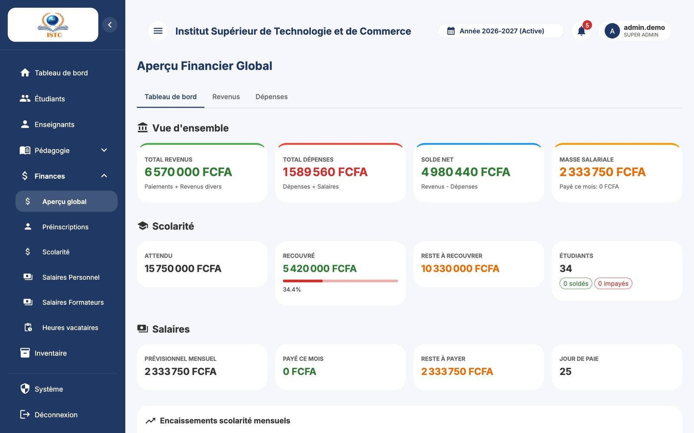
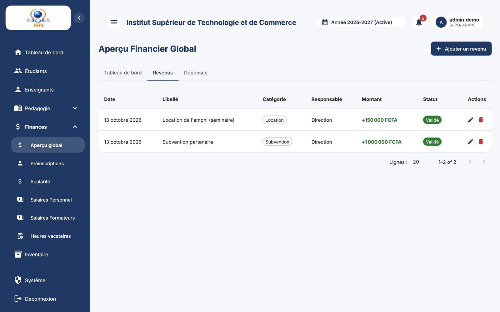

# Aperçu financier (revenus et dépenses)

**Menu :** Finances → Aperçu global — **Accès :** domaine *Finances*.

La page « Aperçu Financier Global » donne la situation de trésorerie et permet d'enregistrer les **autres revenus** et les **dépenses** de l'établissement. Trois onglets : *Tableau de bord*, *Revenus*, *Dépenses*.

## Onglet *Tableau de bord*

- Totaux des revenus, des dépenses et solde (en vert si positif, en rouge si négatif).
- « Paie proche » : rappel des montants de paie à venir.
- Historique des paies par mois (Mois, Brut, Net, Primes, Retenues).
- Paiements de scolarité par mois (Nombre de paiements, Montant total).
- « Dernières transactions ».

## Enregistrer un revenu

Pour une entrée d'argent qui **n'est pas** un paiement de scolarité (subvention, location de salle, prestation…). Les paiements des étudiants se saisissent dans [Scolarité](scolarite.md).

1. Onglet *Revenus* → **Ajouter un revenu**.
2. Renseignez « Libellé », « Montant (FCFA) », « Date », « Catégorie » et éventuellement « Statut » / « Responsable ».
3. Enregistrez.

## Enregistrer une dépense

1. Onglet *Dépenses* → **Ajouter une dépense**.
2. Renseignez « Libellé », « Montant (FCFA) », « Date », « Catégorie », « Statut », « Responsable ».
3. Enregistrez.

!!! info "Dépenses automatiques"
    Le paiement d'une campagne de paie crée **automatiquement** une dépense par bulletin. Ne les saisissez pas une seconde fois à la main.

Le crayon modifie, la corbeille supprime (fenêtre « Confirmer la suppression »).
