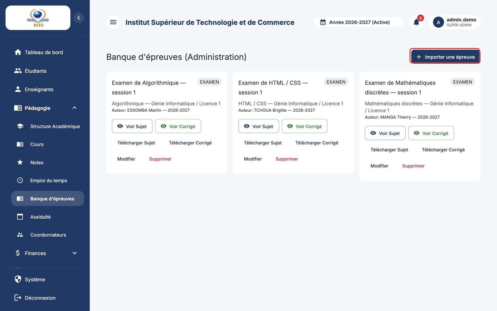
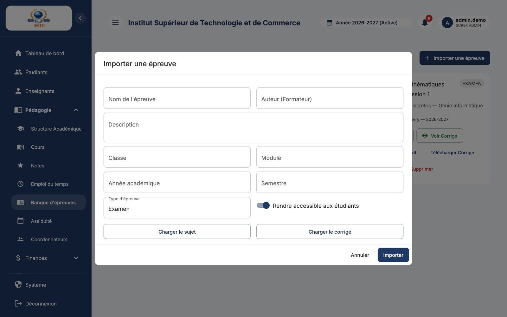

# Banque d'épreuves

**Menu :** Pédagogie → Banque d'épreuves — **Accès :** domaine *Pédagogie*.

La banque d'épreuves archive les sujets d'examen (et leurs corrigés) pour que les étudiants puissent s'entraîner.

## Ajouter une épreuve

1. Cliquez sur **Importer une épreuve**.
2. Remplissez :

    | Champ | Remarque |
    |---|---|
    | Nom de l'épreuve | Ex. « Examen Algorithmique S1 2025 ». |
    | Auteur (Formateur) | |
    | Description | Facultatif. |
    | Classe, Module, Année académique, Semestre | Servent au classement et aux filtres. |
    | Type d'épreuve | Contrôle, examen, rattrapage… |
    | Fichiers | Le **sujet** et, si possible, le **corrigé** (PDF ou image). |
    | Rendre accessible aux étudiants | Cochez pour publier l'épreuve sur le portail étudiant. |

3. Enregistrez.

## Consulter, publier, retirer

Chaque épreuve propose **Voir Sujet**, **Voir Corrigé**, **Télécharger Sujet**, **Télécharger Corrigé**, **Modifier** et **Supprimer**.

- Les épreuves déposées par les formateurs depuis leur portail apparaissent aussi ici. Si le formateur n'a pas coché « Partager immédiatement aux étudiants », l'épreuve reste privée : ouvrez **Modifier** et cochez « Rendre accessible aux étudiants » pour la publier.
- Pour retirer une épreuve du portail sans la supprimer, décochez « Rendre accessible aux étudiants ».
