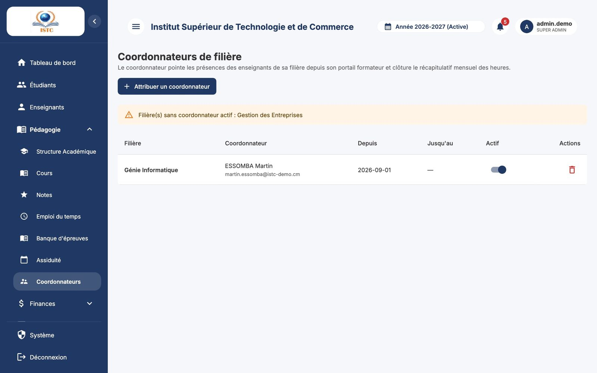
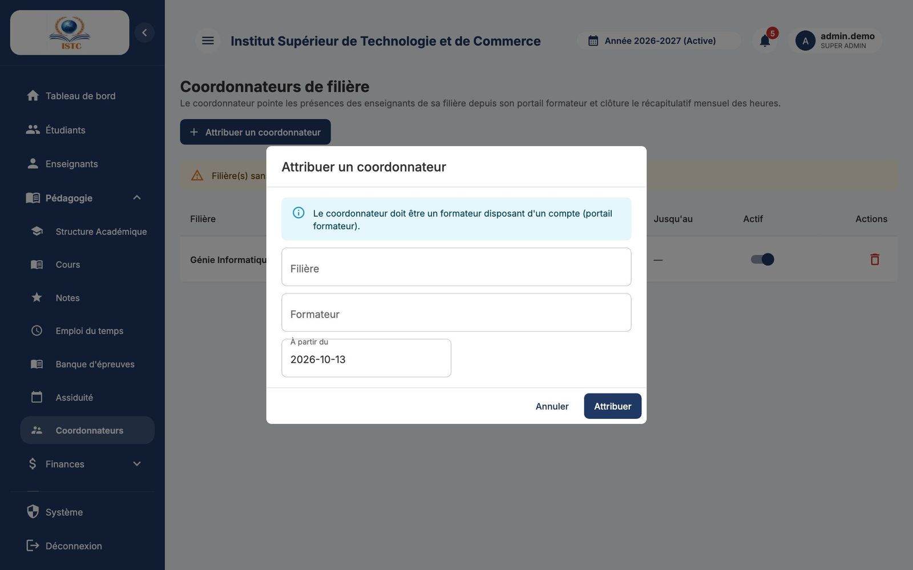

# Coordonnateurs de filière

**Menu :** Pédagogie → Coordonnateurs — **Accès :** domaine *Pédagogie*.

Le **coordonnateur** d'une filière est un formateur chargé de **pointer les heures** (arrivée / fin) des enseignants qui interviennent dans cette filière, puis de **clôturer** le récapitulatif mensuel transmis à la finance. Voir le parcours complet dans [Heures des vacataires](heures-vacataires.md).

## Prérequis

Le futur coordonnateur doit être un **formateur disposant d'un compte portail** (**Enseignants** → **Générer un compte portail**).

## Désigner un coordonnateur

1. Cliquez sur **Attribuer un coordonnateur**.
2. Choisissez la « Filière », le « Formateur » et la date « À partir du ».
3. Validez.

Le formateur voit désormais le menu **Coordination** dans son portail (après reconnexion ou rechargement de la page).

- Un formateur peut coordonner plusieurs filières, et une filière peut avoir plusieurs coordonnateurs (ils voient alors les mêmes pointages). Un même formateur ne peut être désigné qu'une fois pour une filière donnée.
- Pour un changement de coordonnateur, supprimez l'ancien puis désignez le nouveau.
- Le message « Filière(s) sans coordonnateur actif : … » liste les filières à pourvoir.

## Retirer un coordonnateur

Icône **Supprimer** sur la ligne. Les pointages déjà saisis sont conservés.
