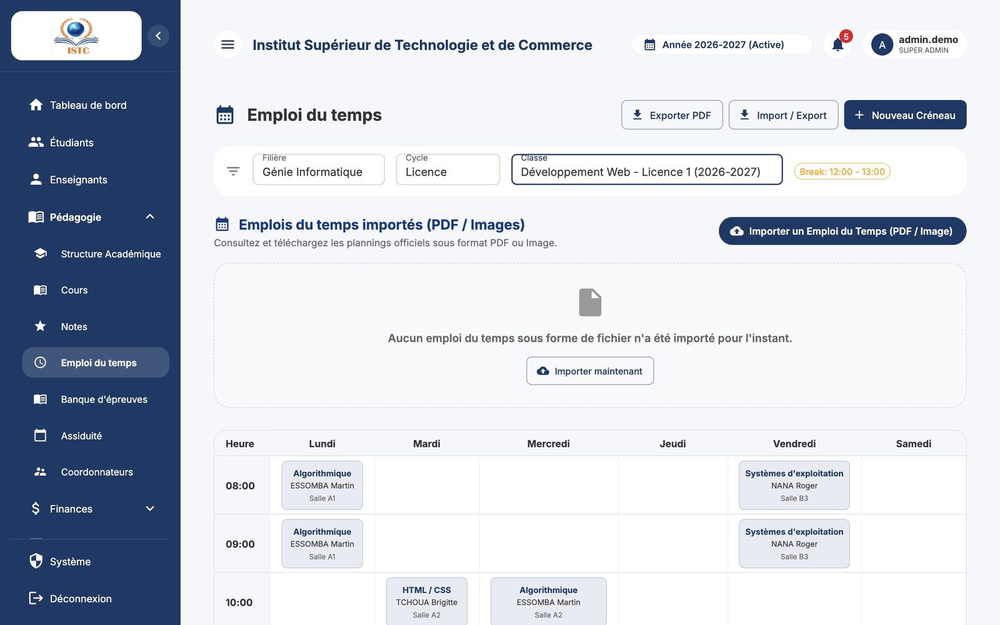
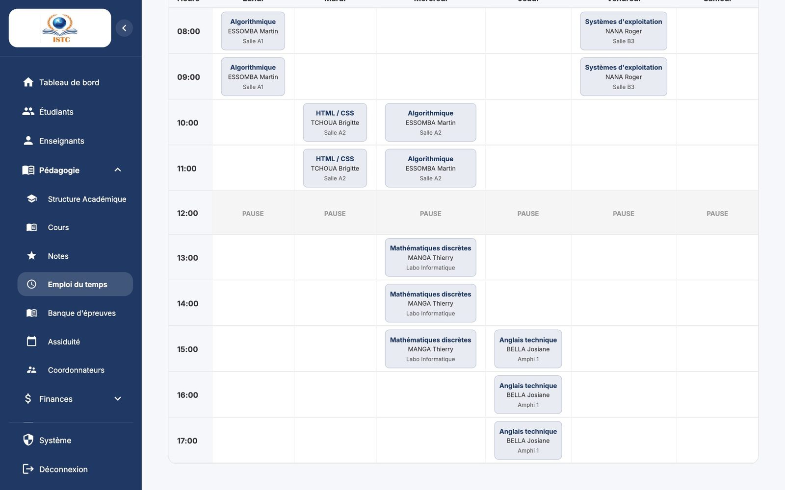
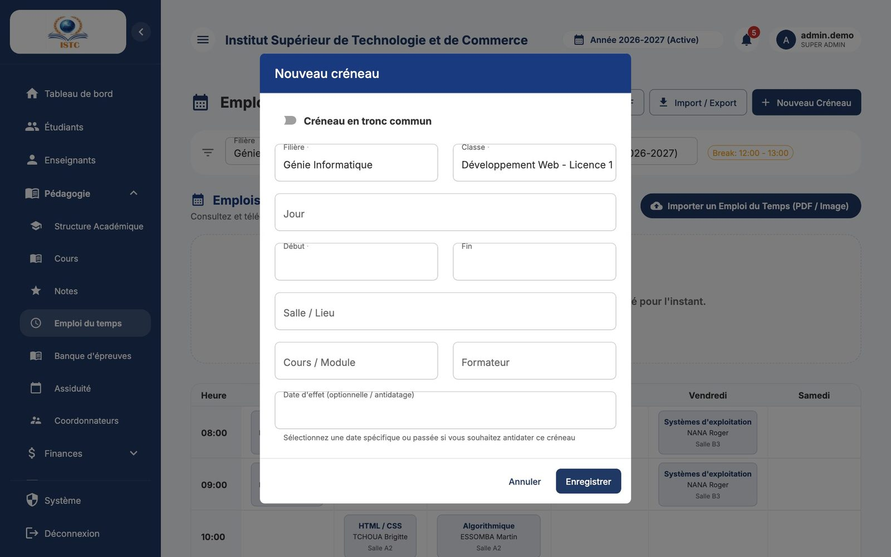

# Emploi du temps

**Menu :** Pédagogie → Emploi du temps — **Accès :** domaine *Pédagogie*.

L'emploi du temps est la **grille hebdomadaire** des cours de chaque classe. Il est essentiel car il alimente :

- le portail étudiant (« Mon Emploi du Temps ») et le portail formateur ;
- les classes et cours visibles par chaque formateur (« Mes Classes », saisie des notes) ;
- le **pointage des heures des vacataires** par les coordonnateurs.

## Afficher l'emploi du temps d'une classe

1. Choisissez successivement la « Filière », le « Cycle », puis la « Classe » dans les listes en haut de page.
2. La grille s'affiche : une colonne par jour, une ligne par heure (colonne « Heure »).

## Ajouter un créneau

1. Cliquez sur **Nouveau Créneau**.
2. Remplissez :

    | Champ | Exemple |
    |---|---|
    | Classe | Développement Web Licence 1 |
    | Jour | Mardi |
    | Début / Fin | 08:00 / 10:00 |
    | Salle / Lieu | Salle B2 |
    | Cours / Module | Algorithmique |
    | Formateur | M. Essomba |
    | Date d'effet (optionnelle / antidatage) | Laisser vide, ou une date passée pour antidater le créneau |

3. Cliquez sur **Enregistrer**.

### Règles vérifiées automatiquement

Le créneau est **refusé** (message rouge) si :

| Message | Cause |
|---|---|
| L'heure de fin doit être postérieure à l'heure de début | Fin avant le début. |
| Impossible de programmer une séance pendant la pause (12:00–13:00) | Le créneau chevauche la pause définie pour le cycle (**Système** → *Paramètres Globaux* → Cycles Globaux). |
| Hors créneau autorisé pour ce cycle (08:00–18:00) | Le créneau dépasse le début ou la fin de journée du cycle. |
| Conflit de salle : cette salle est déjà occupée à ce créneau | La salle est prise par un autre cours au même moment. |
| Conflit de classe : cette classe a déjà un cours à ce créneau | La classe a déjà un cours au même moment. |
| Conflit de formateur : ce formateur a déjà un cours à ce créneau | Le formateur donne déjà un autre cours au même moment. |

!!! note
    Un **même cours** peut partager la salle et le formateur avec plusieurs classes (cours en commun). Les créneaux des **années précédentes** ne bloquent pas la nouvelle année.

## Créneau en tronc commun

Pour un cours suivi au même moment par **toutes les classes d'une ou plusieurs filières** :

1. **Nouveau Créneau**, puis activez l'interrupteur **Créneau en tronc commun**.
2. Choisissez les « Filières concernées » (plusieurs possibles), puis le jour, les heures, la salle, le cours et le formateur.
3. Enregistrez : un créneau est créé pour chaque classe de ces filières.

!!! warning "Remplacement des créneaux existants"
    Si des classes concernées ont déjà un cours sur cette plage horaire, une confirmation vous indique combien de créneaux seront **supprimés et remplacés**. Cliquez sur **Annuler** en cas de doute.

## Modifier ou supprimer un créneau

Cliquez sur le créneau dans la grille : modifiez-le, ou supprimez-le (fenêtre « Supprimer le créneau ? »).

!!! info "Effet sur le pointage"
    Les séances prévues au pointage des coordonnateurs proviennent de l'emploi du temps. Un créneau supprimé n'apparaît plus dans le *Pointage du jour* ; les pointages déjà saisis sont conservés.

## Exporter et publier un emploi du temps officiel

- **Exporter PDF** : télécharge la grille de la classe affichée.
- **Import / Export** : import d'un fichier Excel de créneaux ([mode d'emploi](../premiers-pas.md#importer-une-liste-depuis-excel-import-export)).
- **Importer un Emploi du Temps (PDF / Image)** : publie un document officiel (scan, PDF) pour une classe. Renseignez « Titre de l'emploi du temps », « Classe concernée », « Date d'effet », « Description (Optionnelle) », choisissez le fichier puis **Importer maintenant**. Les étudiants et formateurs le consultent dans leur portail (**Aperçu** / **Télécharger**).
