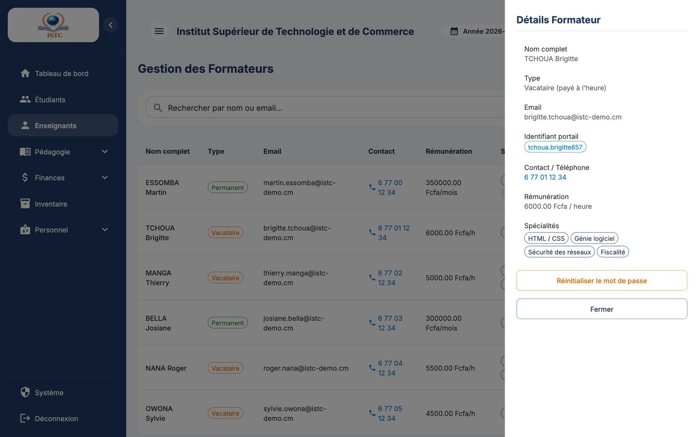
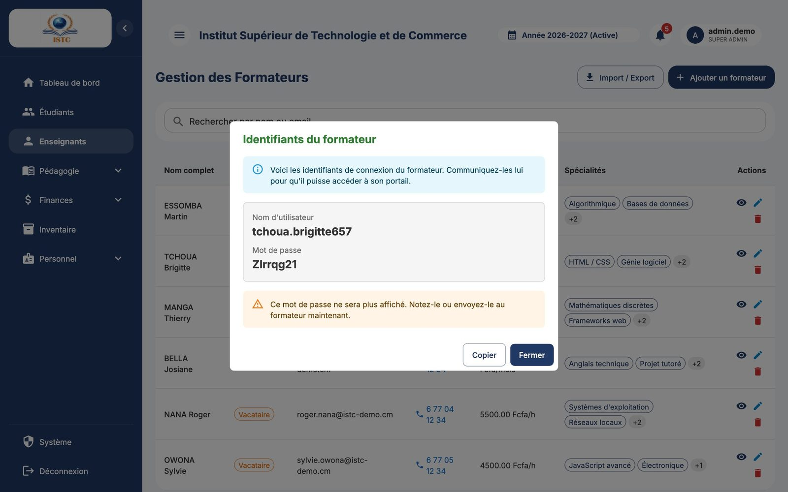

# Enseignants (formateurs)

**Menu :** Enseignants — **Accès :** domaine *Ressources Humaines*.

La page « Gestion des Formateurs » contient tous les enseignants, qu'ils soient **permanents** (salaire mensuel fixe) ou **vacataires** (payés à l'heure).

## Ajouter un formateur

1. Cliquez sur **Ajouter un formateur**.
2. Remplissez :

    | Champ | Remarque |
    |---|---|
    | Nom complet | |
    | Email | Unique ; utilisé pour son compte portail. |
    | Numéro | Téléphone. |
    | Type de formateur | **Permanent** ou **Vacataire**. |
    | Salaire mensuel | Affiché si *Permanent* : montant brut mensuel (FCFA). |
    | Taux horaire | Affiché si *Vacataire* : montant payé par heure de cours effectuée (FCFA). |
    | Spécialités (Modules) | Cours que ce formateur peut enseigner. |

3. Cliquez sur **Enregistrer**.

!!! info "Permanent ou vacataire : quelle différence ?"
    - **Permanent** : la [campagne de paie formateurs](salaires.md) lui verse son salaire mensuel chaque mois.
    - **Vacataire** : il est payé selon les **heures réellement effectuées**, pointées par le coordonnateur de sa filière puis validées par la finance (voir [Heures des vacataires](heures-vacataires.md)). Sans heure validée, il n'apparaît pas dans la campagne du mois.

## Créer le compte portail d'un formateur

Sans compte, le formateur ne peut ni se connecter ni saisir de notes, et ne peut pas être coordonnateur.

1. Ouvrez la fiche du formateur (icône **Voir détails**) : le panneau « Détails Formateur » s'ouvre.
2. Cliquez sur **Générer un compte portail**.
3. La fenêtre « Compte créé » affiche son nom d'utilisateur, son mot de passe et un message prêt à envoyer. La même fenêtre s'ouvre après l'ajout d'un formateur (son compte est créé en même temps).

La fenêtre « Identifiants » (création ou réinitialisation) affiche le **nom d'utilisateur**, le **mot de passe** et un **message prêt à envoyer** (adresse de connexion, identifiants, conseil de changer le mot de passe). Vous pouvez modifier le message, puis :

- **Copier le message** (ou copier un seul champ avec l'icône à sa droite) ;
- **WhatsApp** : ouvre WhatsApp avec le message ; si le numéro de la personne commence par `+` ou `00`, la conversation s'ouvre directement avec elle, sinon choisissez le destinataire ;
- **E-mail** : ouvre votre messagerie avec l'adresse de la personne, l'objet et le message.

!!! warning "Le mot de passe n'est affiché qu'une fois"
    Envoyez-le avant de fermer la fenêtre. Le formateur pourra ensuite le changer dans **Mon profil**.

### Le formateur a perdu son mot de passe

Fiche du formateur → **Réinitialiser le mot de passe**, puis confirmez (droit RH en écriture). La fenêtre « Mot de passe réinitialisé » s'ouvre avec le nouveau mot de passe et le message à envoyer.

## Consulter les cours d'un formateur

Le panneau de détails liste les cours et classes du formateur. Le champ « Filtrer par classe » restreint la liste ; cliquer sur un cours ouvre la fenêtre « Détail du cours ».

## Modifier, supprimer, importer

- Crayon : modifier ; corbeille : supprimer (avec confirmation). Supprimer un formateur retire aussi son accès au portail.
- **Import / Export** : voir [Importer une liste depuis Excel](../premiers-pas.md#importer-une-liste-depuis-excel-import-export).

## Colonne « Rémunération »

Affiche le salaire mensuel (permanent) ou le taux horaire (vacataire), utile pour vérifier les montants avant la paie.
