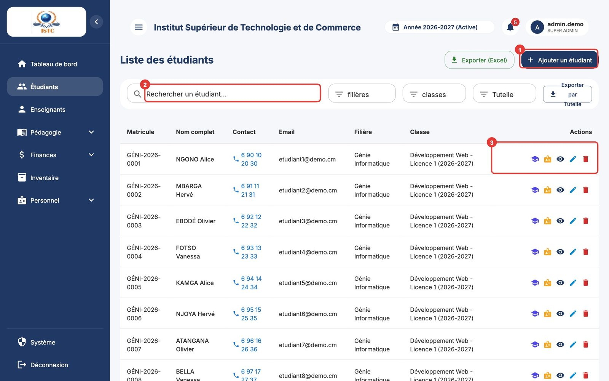
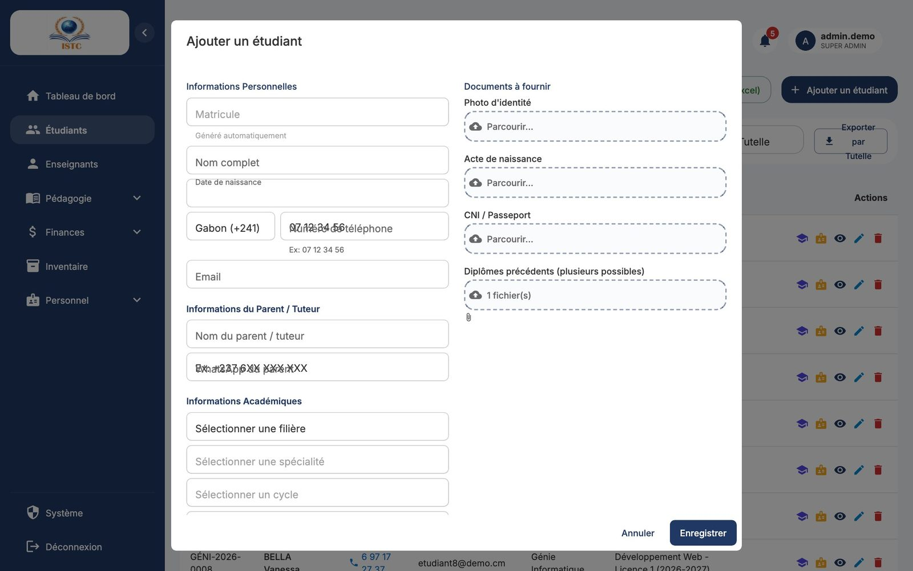
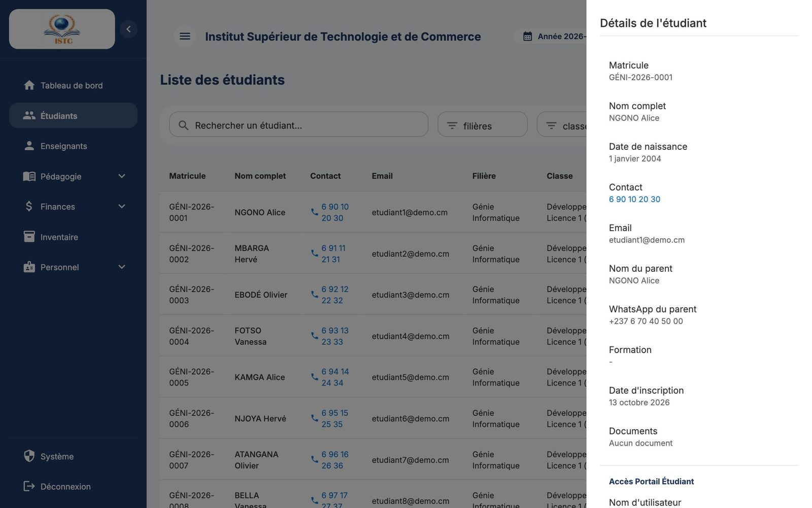
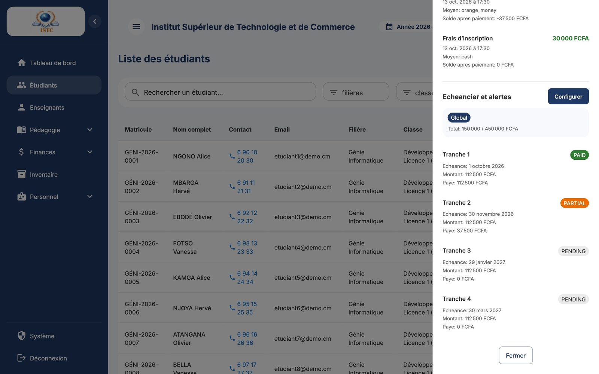
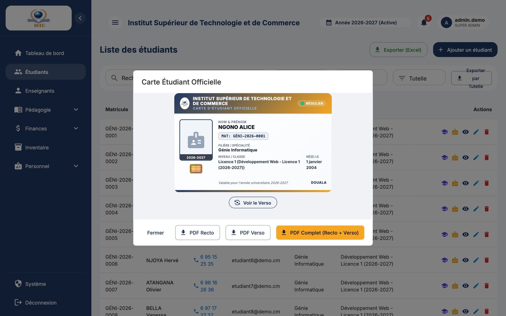
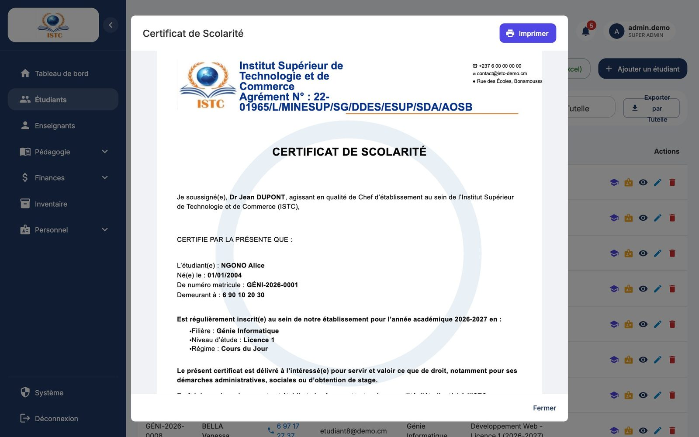

# Étudiants

**Menu :** Étudiants — **Accès :** domaine *Étudiants* (Écriture pour ajouter, modifier ou supprimer).

La page « Liste des étudiants » regroupe tous les dossiers étudiants de l'année sélectionnée.

## Trouver un étudiant

- **Recherche** : tapez un nom, un matricule ou un email dans la case « Rechercher un étudiant… ». La liste se filtre au fur et à mesure.
- **Filtres** « Filière » et « Classe » au-dessus du tableau pour n'afficher qu'un groupe.
- Le tableau affiche : Matricule, Nom complet, Contact, Email, Filière, Classe, Actions.

## Ajouter un étudiant (inscription directe)

À utiliser pour un étudiant qui n'est **pas** passé par la préinscription en ligne. Sinon, utilisez [Préinscriptions](preinscriptions.md) : l'étudiant y est créé automatiquement.

1. Cliquez sur **Ajouter un étudiant**.
2. Remplissez l'identité :

    | Champ | Remarque |
    |---|---|
    | Matricule | Laissez vide : il est **généré automatiquement** (`4 lettres de la filière-année-numéro`, ex. `GÉNI-2026-0007`). |
    | Nom complet | NOM puis prénoms. |
    | Date de naissance | |
    | Numéro de téléphone | |
    | Email | Doit être unique. |
    | Nom du parent / tuteur, WhatsApp du parent | Le WhatsApp sert aux notifications d'absence. Format conseillé : `+237 6XX XXX XXX`. |

3. Choisissez la **Filière**, puis la spécialité, le cycle et le niveau. Le message « Classe attribuée automatiquement : … » confirme la classe retenue.
4. Joignez éventuellement les documents : « Photo d'identité », « Acte de naissance », « CNI / Passeport », « Diplômes précédents (plusieurs possibles) ».
5. Cliquez sur **Enregistrer**.

L'étudiant est créé avec :

- son **inscription** dans la classe pour l'année active ;
- son **compte portail** (nom d'utilisateur et mot de passe initial générés automatiquement).

## Consulter la fiche d'un étudiant

Cliquez sur l'icône **Voir détails** (œil). Le panneau « Détails de l'étudiant » affiche :

- l'identité, la filière, la classe, les documents ;
- les **paiements** enregistrés ;
- **Echeancier et alertes** : le plan de paiement de l'étudiant (étiquette *Global* = échéancier de la classe, *Personnel* = échéancier propre à l'étudiant) et le montant éventuellement en retard ;
- **Accès Portail Étudiant** : « Nom d'utilisateur » et « Mot de passe initial » à communiquer à l'étudiant.

!!! tip "Remettre ses identifiants à un étudiant"
    Ouvrez la fiche, recopiez le nom d'utilisateur et le mot de passe initial de la rubrique *Accès Portail Étudiant*. Si le mot de passe indique « Non disponible ou déjà modifié », demandez à un administrateur de le réinitialiser (**Système** → *Utilisateurs*).

## Donner un échéancier personnalisé à un étudiant

Par défaut, l'étudiant suit l'échéancier de sa classe. Pour un arrangement particulier (paiement étalé, dates décalées) :

1. Ouvrez la fiche de l'étudiant.
2. Dans *Echeancier et alertes*, cliquez sur **Configurer**.
3. Dans la fenêtre « Echeancier personnalise », ajustez chaque tranche (Libelle, Montant, Echeance). **Ajouter une tranche** en crée une nouvelle ; l'icône corbeille en retire une.
4. Enregistrez.

Pour revenir à l'échéancier de la classe, cliquez sur **Revenir au global**.

## Modifier ou supprimer un étudiant

- Icône **Modifier** (crayon) : corrigez les informations puis enregistrez. Le mot de passe initial ne peut pas être modifié ici.
- Icône **Supprimer** (corbeille) puis confirmez.

!!! danger "Suppression"
    Supprimer un étudiant efface son dossier, ses inscriptions, notes et paiements. Pour un étudiant qui quitte l'établissement, conservez plutôt son dossier.

## Carte étudiant et certificat de scolarité

Sur la ligne de l'étudiant :

- **Carte Étudiant** : aperçu de la carte (bouton pour basculer Recto / Verso), puis **PDF Recto**, **PDF Verso**, **PDF Complet (Recto + Verso)** ou **Imprimer**.
- **Certificat de scolarité** : le certificat est généré avec les informations de l'établissement (nom, directeur… définis dans **Système** → *Apparence & École*), puis téléchargé ou imprimé.

## Exporter

- **Exporter (Excel)** : la liste affichée (avec les filtres en cours) dans un fichier Excel.
- **Exporter par Tutelle** : export regroupé par université / organisme de tutelle.
