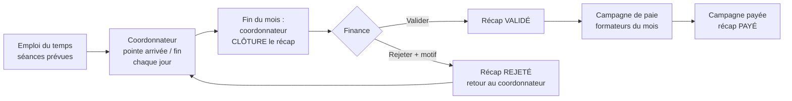
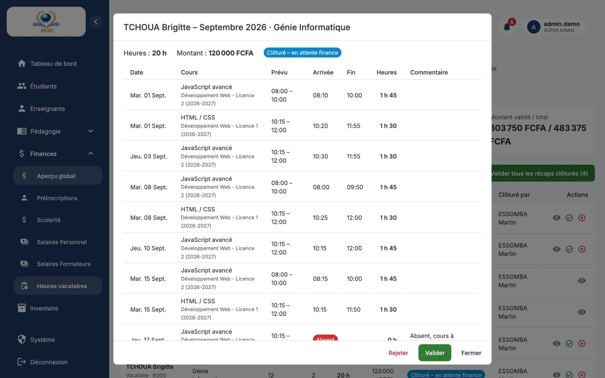

# Heures des enseignants vacataires

**Menu :** Finances → Heures vacataires — **Accès :** domaine *Finances*.

Les enseignants **vacataires** sont payés pour les heures **réellement effectuées**. Ces heures sont pointées par le **coordonnateur** de chaque filière, à partir de l'emploi du temps, puis validées par la finance avant la paie.

## Le parcours complet

| Statut du récapitulatif | Signification | Qui agit |
|---|---|---|
| **Ouvert** | Mois en cours de pointage. | Coordonnateur |
| **Clôturé** | Le coordonnateur a terminé ; en attente de la finance. Les pointages sont verrouillés. | Finance (valider / rejeter) ou coordonnateur (rouvrir) |
| **Rejeté** | La finance a renvoyé le récap avec un motif. Le coordonnateur corrige puis clôture à nouveau. | Coordonnateur |
| **Validé** | Heures approuvées : elles seront payées par la prochaine campagne du mois. | Finance (campagne de paie) |
| **Payé** | La campagne de paie contenant ces heures a été payée. | — |

## Règles de calcul

- Durée d'une séance = **heure de fin − heure d'arrivée** réellement pointées, **arrondie au quart d'heure le plus proche**. Exemple : arrivée 08:05, fin 10:02 → 1 h 57 → **2,00 h**.
- Une séance marquée **Absent** compte 0 heure (elle apparaît dans la colonne Absences).
- Montant du mois = total des heures × **taux horaire** du formateur (fiche **Enseignants**).
- Les heures d'un formateur **permanent** sont pointées pour le suivi mais ne génèrent pas de montant : il est payé par son salaire fixe.
- Un récapitulatif ne peut être clôturé qu'**à partir du dernier jour du mois**.

## Valider les heures du mois (finance)

1. Ouvrez **Finances** → **Heures vacataires**.
2. Choisissez le mois et l'année. Les compteurs indiquent : « À valider », « Non clôturés par les coordonnateurs », « Heures pointées », « Montant validé / total ».
3. Filtrez sur le « Statut » *Clôturé* pour voir ce qui attend votre décision.
4. Pour chaque ligne (un formateur dans une filière), cliquez sur **Détail** pour voir la liste des pointages (date, cours, arrivée, fin, heures).
5. Puis :
    - **Valider** si tout est correct ;
    - **Rejeter (renvoyer au coordonnateur)** sinon : saisissez obligatoirement le « Motif du rejet * » (ex. « Séance du 12 non prévue à l'emploi du temps »), puis **Rejeter**.
Astuce : le bouton **Valider tous les récaps clôturés (n)** valide en une fois tous les récapitulatifs clôturés du mois affiché, après vérification.

6. Quand tous les récaps du mois sont validés, cliquez sur **Aller à la paie formateurs** et générez la campagne du mois (voir [Salaires](salaires.md#2-generer-la-campagne-du-mois)).

!!! warning "Coordonnateur en retard"
    Le compteur « Non clôturés par les coordonnateurs » signale les filières dont le mois n'est pas clôturé. Les heures non validées **ne seront pas payées** par la campagne : relancez le coordonnateur avant de générer la paie.

!!! info "Après la génération de la campagne"
    Un récap déjà intégré à une campagne de paie ne peut plus être rejeté. Pour corriger, supprimez d'abord la campagne (si elle n'est pas payée), rejetez le récap, puis régénérez la campagne une fois le récap revalidé.

## Ce que voit l'enseignant

Chaque formateur suit ses heures en temps réel dans son portail, rubrique **Mes heures** (heures effectuées, séances, absences, montant estimé, statut du récapitulatif). Voir [Portail formateur](../portail-formateur.md#mes-heures).
