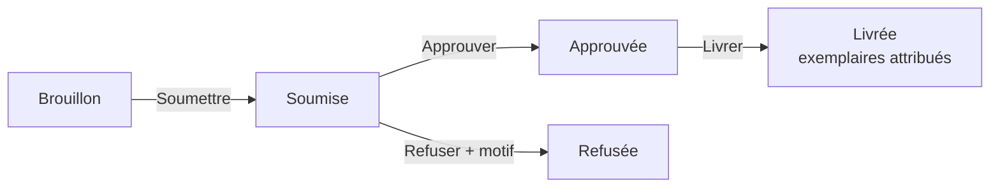

# Inventaire et demandes de matériel

**Menu :** Inventaire — **Accès :** domaine *Logistique / Inventaire*.

L'inventaire suit le matériel de l'établissement **article par article** (ex. « Vidéoprojecteur ») et **exemplaire par exemplaire** (chaque vidéoprojecteur physique, avec sa référence et son numéro de série). Quatre onglets : *Articles & Stock*, *Demandes*, *Mouvements*, *Statistiques*.

## Onglet *Articles & Stock*

### Créer un article

1. **Nouvel article**.
2. Remplissez « Nom de l'article », « Description », « Catégorie », « Prix unitaire (FCFA) », « Fournisseur », « Seuil d'alerte » (stock minimal en dessous duquel l'article est signalé) et « Stock initial » (nombre d'exemplaires déjà possédés).
3. Enregistrez. Un exemplaire est créé pour chaque unité du stock initial.

Le tableau indique pour chaque article : Référence, Catégorie, **En stock**, **Utilisés**, **En panne**, Total, Prix unitaire.

### Ajouter du stock (nouvel achat)

Icône **Ajouter au stock** sur la ligne de l'article → indiquez la « Quantité », la « Condition », la « Localisation » et la « Date d'acquisition » → **Ajouter**. Un mouvement *Entrée en stock* est enregistré.

### Gérer les exemplaires

En ouvrant un article, la liste de ses exemplaires apparaît (Réf., N° Série, Statut, Condition, Localisation, Attribué à). Actions possibles :

| Icône | Effet |
|---|---|
| Modifier N° série / Description | Compléter la fiche de l'exemplaire. |
| Marquer en panne | Statut *En panne* : il n'est plus disponible. |
| Retourner en stock / Remettre en stock | L'exemplaire attribué ou réparé redevient disponible. |
| Réformer | Sortie définitive de l'inventaire (matériel hors d'usage, vendu, perdu). |

Statuts possibles : *En stock*, *En utilisation*, *En panne*, *En maintenance*, *Réformé*.

## Onglet *Demandes* — demandes de matériel

Une **demande** permet à un formateur ou à un membre du personnel d'obtenir du matériel. Elle suit ce circuit :

### Créer une demande

1. **Nouvelle demande**. L'assistant comporte plusieurs étapes (**Suivant** / **Précédent**).
2. Renseignez l'« Objet de la demande », le « Motif / Justification », le « Demandeur » et la « Priorité » (Basse, Normale, Haute, Urgente).
3. Ajoutez les articles : choisissez l'« Article », la « Qté », éventuellement des « Notes ». Répétez pour chaque article.
4. Vérifiez le récapitulatif (« Vérifiez les informations avant de soumettre la demande. ») puis validez.

Chaque demande reçoit une référence unique (`DEM-…`).

### Traiter une demande

Sur la ligne de la demande :

1. **Soumettre** (si elle est en brouillon).
2. **Approuver** ou **Refuser** (saisir le « Motif du refus »).
3. **Livrer** : les exemplaires disponibles sont attribués au demandeur (statut *En utilisation*) et un mouvement *Sortie / Attribution* est enregistré.

!!! warning
    Si le stock disponible est insuffisant pour **une seule** ligne, la livraison entière est refusée (« Stock insuffisant, aucune sortie effectuée. ») avec le détail par article (ex. « Chaise : seulement 2/4 disponibles »). Ajoutez du stock puis cliquez de nouveau sur **Livrer**.

## Onglet *Mouvements*

Le journal de toutes les opérations : Date, Exemplaire, Type (*Entrée en stock*, *Sortie / Attribution*, *Retour en stock*, *Transfert*, *Envoi en maintenance*, *Réforme*), Motif, Destinataire. Il sert de traçabilité en cas de contrôle ou de perte.

## Onglet *Statistiques*

Par article : nombre d'exemplaires, en utilisation, taux d'utilisation, stock disponible. Utile pour planifier les achats.
