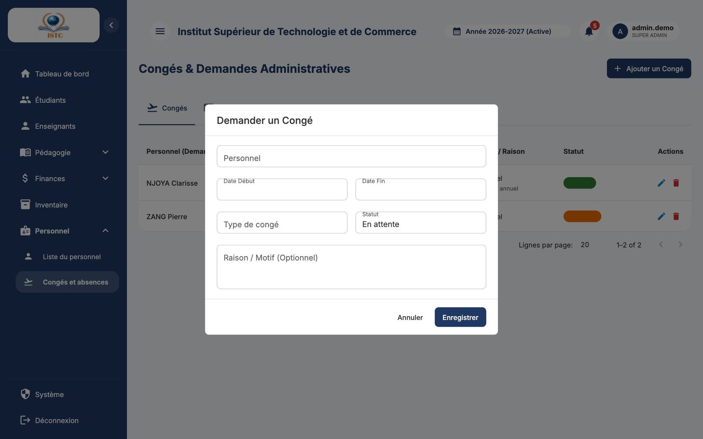

# Personnel et congés

**Menus :** Personnel → Liste du personnel, et Personnel → Congés et absences — **Accès :** domaine *Ressources Humaines*.

## Liste du personnel

La page « Gestion du Personnel » contient les employés **non enseignants** (secrétariat, comptabilité, entretien, sécurité…). Les enseignants se gèrent dans [Enseignants](enseignants.md).

### Ajouter un membre du personnel

1. Cliquez sur **Ajouter un membre**.
2. Remplissez :

    | Champ | Remarque |
    |---|---|
    | Nom complet | |
    | Numéro | Téléphone. |
    | Fonction | Poste occupé. |
    | Salaire | Salaire mensuel de base (FCFA) utilisé par la [paie du personnel](salaires.md). |
    | Date d'embauche | Détermine l'ancienneté et le droit aux congés. |
    | Solde congés initial | Nombre de jours de congés annuels (ex. `18`). |

3. Enregistrez.

La colonne « Congés » affiche le solde **restant**. **Import / Export** permet d'importer une liste Excel ([mode d'emploi](../premiers-pas.md#importer-une-liste-depuis-excel-import-export)).

!!! note "Compte de connexion"
    Ajouter un membre du personnel ne crée pas de compte de connexion. Si la personne doit utiliser SmartCampus, créez son compte dans **Système** → *Utilisateurs*.

## Congés et absences

La page « Congés & Demandes Administratives » a deux onglets : *Congés* et *Demandes* (rappel des demandes de matériel faites dans l'[Inventaire](inventaire.md)).

### Enregistrer une demande de congé

1. Onglet *Congés* → **Ajouter un Congé**.
2. Remplissez « Personnel », « Date Début », « Date Fin », « Type de congé » (ex. *Annuel*, *Maladie*, *Maternité*…), « Statut » (*En attente*) et éventuellement « Raison / Motif (Optionnel) ».
3. Enregistrez.

### Accepter ou refuser

Modifiez la ligne (crayon) et changez le « Statut » en **Accepté** ou **Refusé**.

| Action | Effet sur le solde |
|---|---|
| Demande *En attente* | Aucun |
| Passage à **Accepté** | Le solde est **débité** du nombre de **jours ouvrés** (samedis et dimanches exclus) |
| Congé accepté passé à **Refusé**, modifié ou supprimé | Le solde est **recrédité** ou ajusté automatiquement |

Exemple : un congé du lundi 2 au vendredi 6 novembre = 5 jours ouvrés ; un solde de 10 jours passe à 5.

### Refus automatiques

| Message | Cause |
|---|---|
| La date de fin doit être postérieure ou égale à la date de début | Dates inversées. |
| La période choisie ne contient aucun jour ouvré (uniquement des weekends) | Seulement un samedi / dimanche. |
| Ce membre du personnel n'est pas encore éligible aux congés (Ancienneté : 0 an(s)). Il faut au moins 1 an. | Embauché depuis moins d'un an. |
| Solde de congés insuffisant. Restant : X jour(s) ouvré(s), Demandé : Y jour(s). | Pas assez de jours. |
