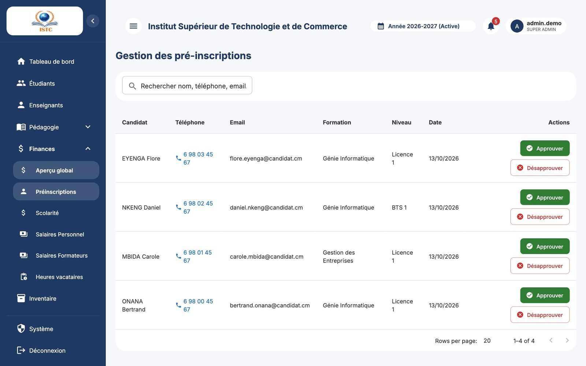
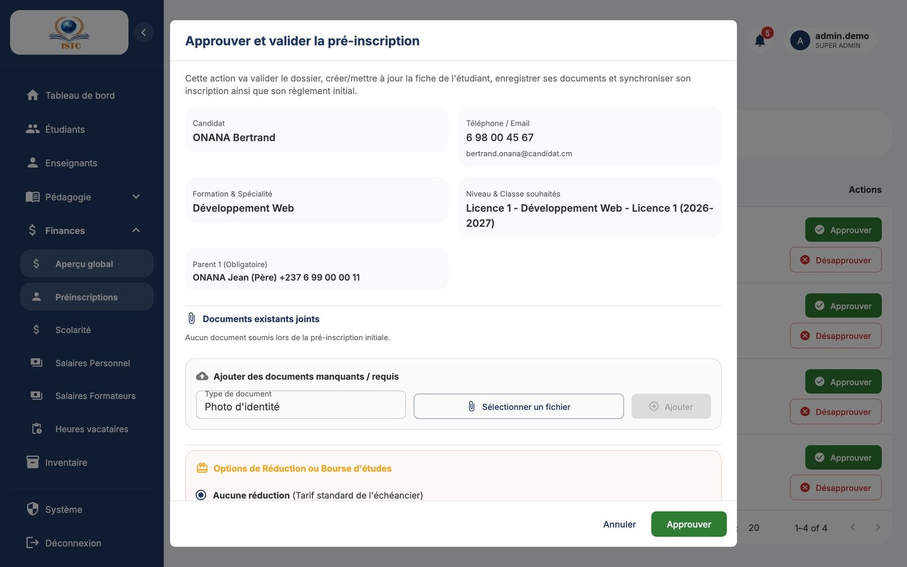
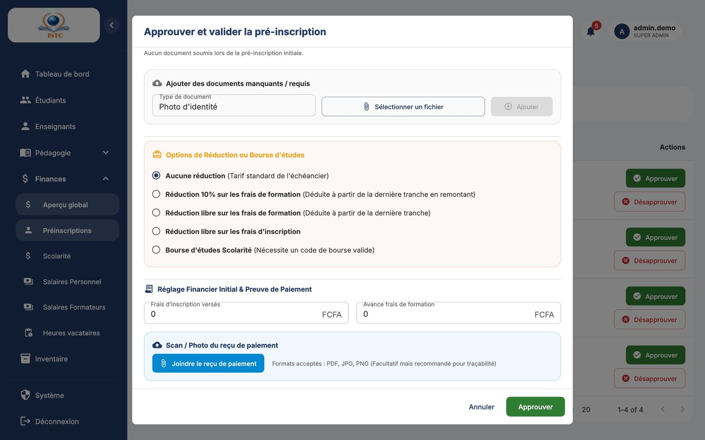

# Préinscriptions (traitement par l'administration)

**Menu :** Finances → Préinscriptions — **Accès :** domaine *Finances*.

La page « Gestion des pré-inscriptions » liste les demandes envoyées par les candidats via le [formulaire en ligne](../preinscription-candidat.md), **en attente** de décision : Candidat, Téléphone, Email, Formation, Niveau, Date.

## Approuver une préinscription

1. Sur la ligne du candidat, cliquez sur **Approuver**. La fenêtre « Approuver et valider la pré-inscription » s'ouvre.
2. Vérifiez les informations et les documents. Vous pouvez ajouter un document manquant (« Type de document » puis **Ajouter**).
3. Choisissez le **type de réduction** :

    | Option | Effet |
    |---|---|
    | **Aucune réduction** (Tarif standard de l'échéancier) | L'étudiant suit l'échéancier de sa classe. |
    | **Réduction 10% sur les frais de formation** (Déduite à partir de la dernière tranche en remontant) | 10 % de la scolarité est déduit, **à partir de la dernière tranche**. Exemple : 4 × 100 000 → 100 000, 100 000, 100 000, 60 000. |
    | **Réduction libre sur les frais de formation** (Déduite à partir de la dernière tranche) | Tapez le « Montant de la réduction ». |
    | **Réduction libre sur les frais d'inscription** | Tapez le « Montant de la réduction ». |
    | **Bourse d'études Scolarité** (Nécessite un code de bourse valide) | Tapez le « Code de la bourse ». Le message « Bourse valide ! Montant : … » confirme le code. |

4. Si le candidat paie au moment de l'inscription, indiquez les « Frais d'inscription versés » et l'« Avance frais de formation ». Ces paiements sont enregistrés immédiatement.
5. Validez.

En une seule opération, SmartCampus :

- crée l'**étudiant** avec son **matricule** (si un étudiant existe déjà avec le même email, son dossier est **mis à jour** au lieu d'être dupliqué) ;
- crée son **compte portail étudiant** (identifiants visibles dans **Étudiants** → *Voir détails* → *Accès Portail Étudiant*) ;
- l'**inscrit** dans la classe demandée pour l'année active ;
- crée son **échéancier** (avec la réduction éventuelle), ses **paiements** initiaux et marque la bourse comme utilisée ;
- retire la demande de la liste des préinscriptions.

!!! warning "Messages de refus"
    - *La bourse avec le code '…' est introuvable* ou *La bourse '…' a déjà été utilisée* : vérifiez le code dans **Scolarité** → *Gestion des Bourses* (les majuscules/minuscules ne comptent pas).

## Refuser une préinscription

Cliquez sur **Désapprouver** puis confirmez. La demande est **supprimée** ; aucun étudiant n'est créé. Pensez à prévenir le candidat.
