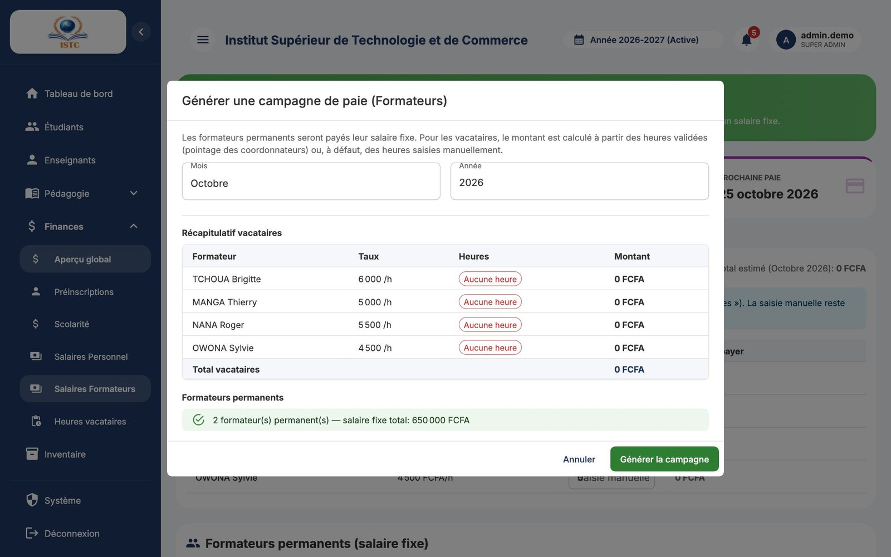

# Salaires (personnel et formateurs)

**Menus :** Finances → Salaires Personnel, et Finances → Salaires Formateurs — **Accès :** domaine *Finances*.

Les deux pages fonctionnent de la même façon. Seule différence : la page **Formateurs** gère en plus les **heures des vacataires**.

Chaque page comporte six onglets : *Campagnes de paie*, *Primes & Indemnités*, *Retenues*, *Avances sur salaire*, *Bulletins*, *Statistiques*.

## Le principe


Chaque mois, on **génère une campagne de paie** : SmartCampus crée un **bulletin** par bénéficiaire, avec :

```
Salaire net = Salaire de base + Primes − Retenues − Échéance d'avance du mois
```

| Bénéficiaire | Salaire de base |
|---|---|
| Membre du personnel | Le « Salaire » de sa fiche (**Personnel** → Liste du personnel) |
| Formateur permanent | Le « Salaire mensuel » de sa fiche |
| Formateur vacataire | Heures validées du mois × taux horaire (voir [Heures des vacataires](heures-vacataires.md)) |

La campagne passe ensuite par trois statuts :


!!! tip "Calendrier conseillé"
    1. Entre le 1er et le 25 : saisir les primes, retenues et avances du mois.
    2. Fin de mois : (formateurs) attendre que les heures des vacataires soient **validées**.
    3. Générer la campagne, contrôler les bulletins, **Valider**, puis **Marquer comme payée** une fois les virements faits.

    L'alerte « Échéance proche ! » rappelle que la date de paie approche.

## 1. Préparer : primes, retenues, avances

### Ajouter une prime ou une indemnité


Onglet *Primes & Indemnités* → **Ajouter une prime**.

| Champ | Remarque |
|---|---|
| Bénéficiaire (ou Formateur) | La personne concernée. |
| Type de prime | Prime de transport, de logement, de rendement, d'ancienneté, de responsabilité, de risque, de panier, Heures supplémentaires, Autre. |
| Montant (FCFA) | Montant mensuel. |
| Libellé (optionnel) | Précision affichée sur le bulletin. |
| Permanente | **Coché** : appliquée **chaque mois** automatiquement. **Décoché** : prime ponctuelle, appliquée seulement entre la « Date début » et la « Date fin ». |
| Active | Décochez pour suspendre la prime sans la supprimer. |

Exemple : une prime de rendement exceptionnelle de 15 000 FCFA pour juillet → Permanente décoché, Date début 01/07, Date fin 31/07. Elle apparaîtra sur le bulletin de juillet et pas sur celui d'août.

### Ajouter une retenue


Onglet *Retenues* → **Ajouter une retenue**. Mêmes champs, avec le « Type de retenue » : CNPS, IRPP, Remboursement avance, Retenue pour absence, Remboursement prêt, Autre.

### Accorder une avance sur salaire


Onglet *Avances sur salaire* → **Nouvelle avance**.

| Champ | Exemple |
|---|---|
| Bénéficiaire | |
| Montant total (FCFA) | 60 000 |
| Nombre d'échéances (mois) | 3 |
| Début remboursement | 01/09/2026 |
| Motif | Frais médicaux |

L'« Échéance mensuelle » (ici 20 000 FCFA) est calculée automatiquement et **déduite de chaque bulletin** jusqu'au remboursement complet. Le tableau suit le montant remboursé et la progression ; l'avance passe au statut *Remboursée* à la dernière échéance.

## 2. Générer la campagne du mois




1. Onglet *Campagnes de paie* → **Générer une campagne**.
2. Choisissez le « Mois » et l'« Année ».
3. **Page Formateurs uniquement** : le tableau « Heures effectuées - Formateurs vacataires » montre, pour chaque vacataire, le taux horaire, les heures validées et le montant à payer. Les heures proviennent des récapitulatifs **validés**. Pour un vacataire sans pointage (« Aucune heure »), vous pouvez cocher **Saisie manuelle** et taper ses heures. Le tableau « Formateurs permanents (salaire fixe) » rappelle les salaires fixes.
4. Confirmez la génération.

Règles :

- **Une seule campagne par mois** et par type (personnel / formateurs). Une deuxième tentative est refusée.
- Une personne dont le salaire de base est nul (vacataire sans heures, salaire non renseigné) n'a pas de bulletin.

## 3. Contrôler les bulletins


- Dans la liste des campagnes, l'icône **Voir les bulletins** ouvre le détail de la campagne (un bulletin par personne).
- L'onglet *Bulletins* liste tous les bulletins ; **Voir détail** ouvre le « Bulletin de paie » : salaire de base, primes (+), retenues (−), **NET À PAYER**.

Une erreur ? Tant que la campagne n'est pas payée : supprimez-la (corbeille), corrigez la prime, la retenue, le salaire ou les heures, puis générez-la de nouveau.

## 4. Valider puis payer

1. Icône **Valider** sur la campagne : elle passe au statut *Validée*.
2. Après avoir effectué les paiements, icône **Marquer comme payée**. SmartCampus :
    - passe tous les bulletins au statut *Payé* ;
    - enregistre une **dépense** par bulletin dans l'aperçu financier ;
    - comptabilise l'échéance des avances comme remboursée ;
    - passe les récapitulatifs d'heures des vacataires au statut *Payé*.

!!! danger "Une campagne payée est définitive"
    Elle ne peut plus être supprimée (sinon les dépenses et remboursements enregistrés seraient faussés). Une campagne ne peut pas être payée avant d'avoir été validée.

## 5. Statistiques


L'onglet *Statistiques* présente l'« Historique mensuel » : total brut, primes, retenues et net par mois (et, côté formateurs, le total versé aux vacataires).
