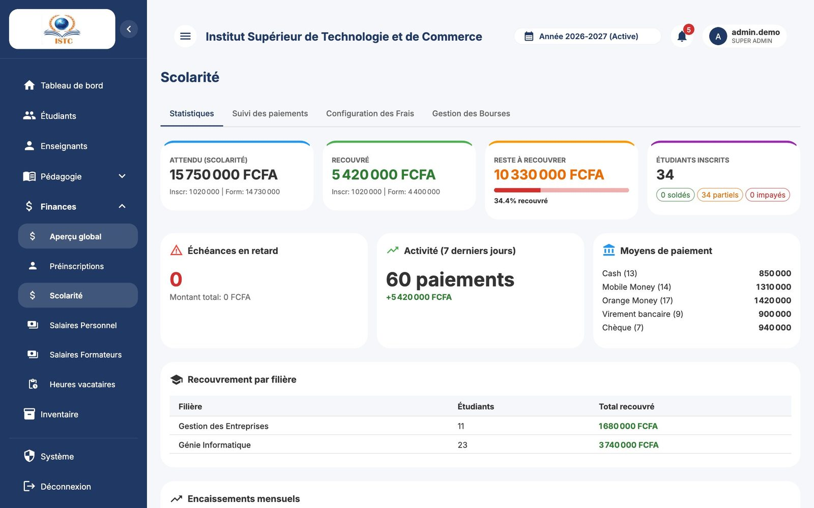
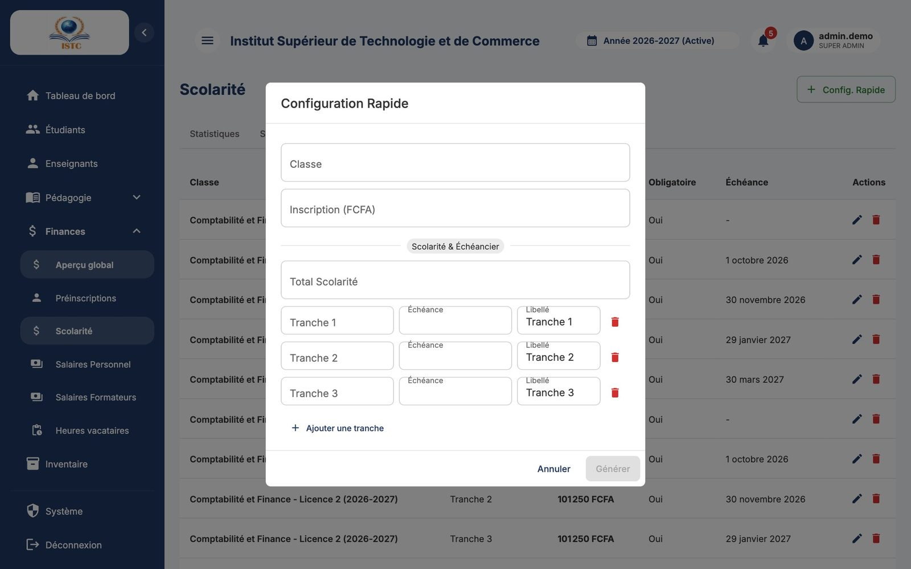
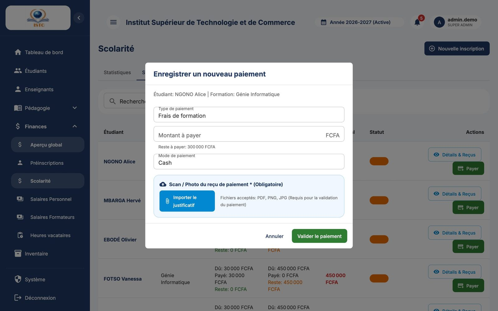
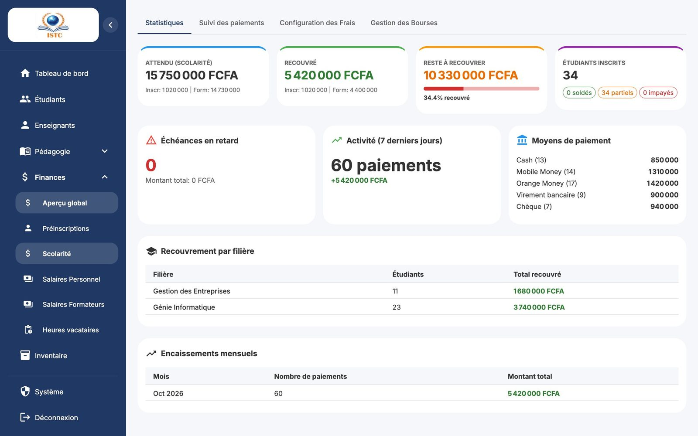
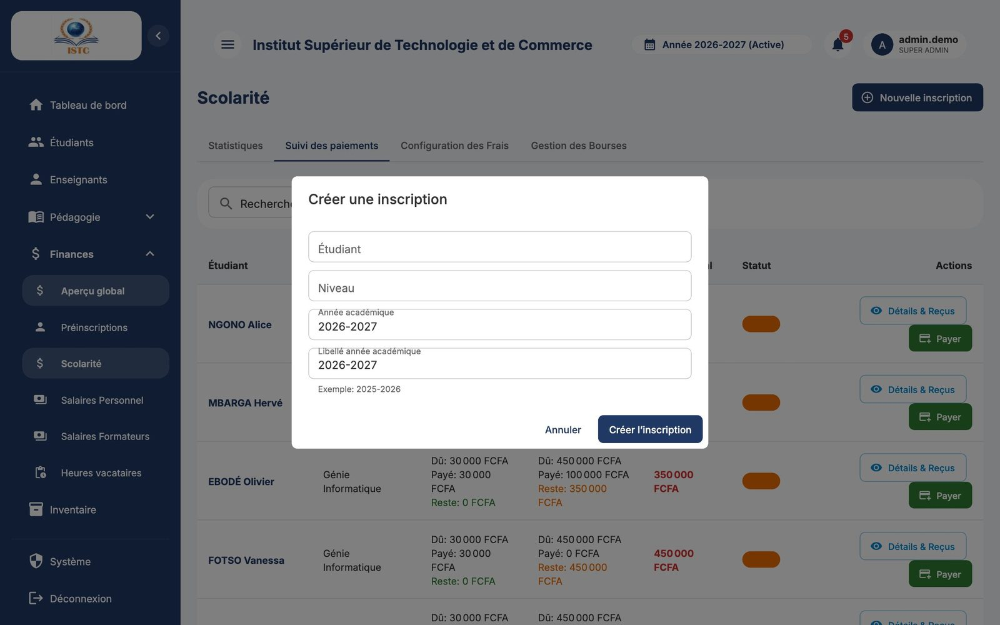

# Scolarité et paiements

**Menu :** Finances → Scolarité — **Accès :** domaine *Finances* (Écriture pour enregistrer des paiements).

La page « Scolarité » gère tout ce que les étudiants doivent payer et ont payé. Elle comporte quatre onglets : *Statistiques*, *Suivi des paiements*, *Configuration des Frais*, *Gestion des Bourses*.

## Comprendre les montants



Pour chaque étudiant, la plateforme distingue deux catégories :

| Catégorie | Contenu | Comment la plateforme la reconnaît |
|---|---|---|
| **Inscription** | Frais d'inscription | Tout frais dont le libellé contient le mot « inscription » |
| **Formation** (scolarité) | Toutes les tranches de scolarité | Tous les autres frais de la classe |

Ensuite :

```
Montant dû       = frais de la classe − réductions / bourses de l'étudiant
Solde restant    = montant dû − total des paiements enregistrés
```

Les mêmes chiffres apparaissent partout : suivi des paiements, fiche de l'étudiant, tableau de bord et portail étudiant (« Ma Scolarité »).

!!! warning "Nommez correctement les frais"
    Un frais d'inscription doit contenir le mot **inscription** dans son libellé (ex. « Frais d'inscription »). Un libellé comme « Dossier » serait compté comme de la scolarité.

## Configurer les frais d'une classe

À faire **pour chaque classe**, avant les premières inscriptions de l'année. Onglet *Configuration des Frais*.

### Méthode rapide (recommandée) : Config. Rapide




1. Cliquez sur **Config. Rapide**.
2. Choisissez la « Classe ».
3. Tapez le montant « Inscription (FCFA) » (ex. `25000`).
4. Dans la partie *Scolarité & Échéancier*, tapez le « Total Scolarité » (ex. `400000`).
5. Pour chaque tranche : montant, date d'« Échéance » et « Libellé » (ex. *Tranche 1*, 100 000, 15/10/2026). **Ajouter une tranche** ajoute une ligne ; la corbeille rouge en supprime une.
6. Le compteur `400 000 / 400 000` doit devenir **vert** : la somme des tranches doit être égale au total. Sinon le bouton reste grisé.
7. Cliquez sur **Générer**.

Résultat : les frais (inscription + chaque tranche) et l'**échéancier de la classe** sont créés. Les étudiants de la classe suivent automatiquement cet échéancier.

### Modifier ou supprimer un frais

Dans le tableau (colonnes Libellé, Montant, Obligatoire, Échéance), le crayon modifie (« Classe », « Libellé », « Montant (FCFA) », « Date d'échéance »), la corbeille supprime.

!!! note
    Un même libellé ne peut exister qu'une fois par classe.

## Enregistrer un paiement




1. Onglet *Suivi des paiements*.
2. Recherchez l'étudiant (nom, matricule) ou filtrez par classe ou par statut (*Soldé*, *Partiel*, *Non payé*).
3. Sur sa ligne, cliquez sur **Payer**. La fenêtre « Enregistrer un nouveau paiement » s'ouvre.
4. Remplissez :

    | Champ | Choix |
    |---|---|
    | Type de paiement | **Frais d'inscription** ou **Frais de formation** |
    | Montant à payer | Le montant **reçu** (un paiement partiel est possible). |
    | Mode de paiement | Cash, Mobile Money, Orange Money, Virement bancaire, Chèque |
    | Scan / Photo du reçu de paiement * (Obligatoire) | Cliquez sur **Importer le justificatif** et choisissez la photo du reçu ou du bordereau. |

5. Enregistrez.

Le solde est recalculé immédiatement. Pour la scolarité, le paiement est **imputé sur les tranches dans l'ordre** : la tranche 1 est soldée en premier, le surplus passe sur la tranche 2, etc.

Exemple : échéancier 4 × 100 000 ; l'étudiant paie 150 000 → *Tranche 1* payée, *Tranche 2* partiellement payée (50 000).

### Consulter l'historique et les justificatifs


**Détails & Reçus** sur la ligne de l'étudiant : liste de ses paiements, « Échéancier des Tranches » avec l'état de chaque tranche, et bouton **Voir le justificatif** pour chaque paiement. **Enregistrer un paiement** est aussi disponible depuis cette fenêtre.

## Suivre les retards



- Onglet *Statistiques* : chiffres clés (étudiants *soldés*, *partiels*, *impayés*), recouvrement par filière (Filière, Étudiants, Total recouvré) et par mois.
- Bloc **Échéances en retard** : chaque tranche dont la date est dépassée et qui n'est pas soldée (Étudiant, Tranche, Échéance, Reste à payer, Alerte). Plus le retard est important, plus l'alerte est forte.

## Bourses


Une **bourse** est un montant déduit de la scolarité d'un étudiant, identifié par un **code unique**.

1. Onglet *Gestion des Bourses* → **Créer une Bourse**.
2. Remplissez « Code Bourse » (ex. `EXCEL-2026`), « Description / Motif » et « Montant de la bourse (FCFA) ».
3. Enregistrez. La bourse apparaît comme **Disponible**.

Le code est saisi lors de l'[approbation de la préinscription](preinscriptions.md) du bénéficiaire. La bourse passe alors à **Utilisée** : **un code ne sert qu'une seule fois**.

## Réinscrire un ancien étudiant



Pour un étudiant qui passe en année supérieure (nouvelle année académique) :

1. Onglet *Suivi des paiements* → **Nouvelle inscription**.
2. Dans « Créer une inscription », choisissez l'« Étudiant », le « Niveau » et l'« Année académique ».
3. Enregistrez. L'étudiant est rattaché à sa nouvelle classe et les frais de celle-ci s'appliquent.
