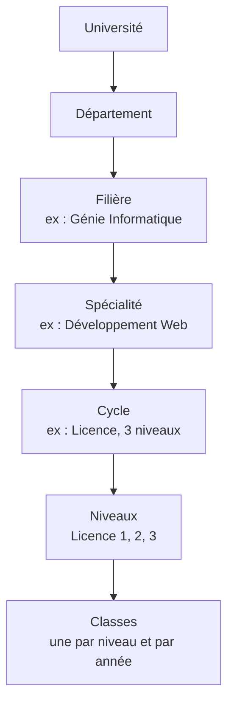
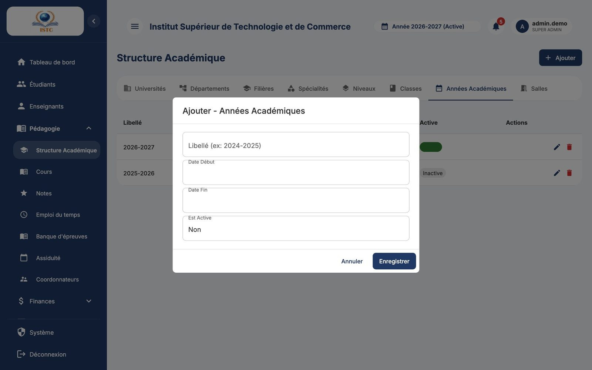

# Structure académique

**Menu :** Pédagogie → Structure Académique — **Accès :** domaine *Pédagogie* (Écriture pour modifier).

Cette page décrit l'organisation de l'établissement. Elle se remplit **une fois** à la mise en service, puis évolue peu. Elle comporte huit onglets.

## Fonctionnement commun à tous les onglets

1. Cliquez sur l'onglet voulu.
2. **Ajouter** ouvre le formulaire ; remplissez-le puis **Enregistrer** (ou **Annuler**).
3. Dans le tableau, l'icône crayon modifie une ligne, la corbeille la supprime (avec confirmation).

!!! danger "Supprimer un élément de la structure"
    Supprimer une filière, un niveau ou une classe peut supprimer ou détacher les éléments qui en dépendent (classes, inscriptions…). Ne supprimez qu'un élément créé par erreur et encore inutilisé. Préférez la modification.

## Onglet *Universités*

L'établissement (ou les universités de tutelle). Champs : « Nom », « Code », « Description ».

## Onglet *Départements*

Regroupement de filières. Champs : « Nom du département », « Université », « Description ».

## Onglet *Filières*

La formation principale (par exemple *Génie Informatique*, *Gestion*).

| Champ | Exemple |
|---|---|
| Nom de la filière (ex: Génie Informatique) | Génie Informatique |
| Département | Sciences et Technologies |
| Nom du responsable | Dr Mbarga |

!!! info "Matricules"
    Les 4 premières lettres du nom de la filière forment le début du matricule des étudiants (`GÉNI-2026-0001`). Choisissez le nom avant d'inscrire des étudiants.

## Onglet *Spécialités*

Une option à l'intérieur d'une filière. **C'est ici que les niveaux et les classes sont générés automatiquement.**

| Champ | Exemple |
|---|---|
| Filière | Génie Informatique |
| Nom de la spécialité (ex: Développement Web) | Développement Web |
| Type de Cycle (ex: Licence, BTS, Master) | Licence |
| Nombre de niveaux (ex: 3 pour Licence 1, 2, 3) | 3 |

Résultat : les niveaux *Licence 1, 2, 3* et les classes *Développement Web Licence 1*, *Développement Web Licence 2*, *Développement Web Licence 3* sont créés pour chaque année académique.

## Onglet *Niveaux*

Liste des niveaux (Licence 1, BTS 2…). Normalement générés par l'onglet Spécialités ; ajoutez un niveau ici seulement pour compléter un cycle existant (la classe correspondante sera créée automatiquement).

## Onglet *Classes*

Une classe = un niveau d'une spécialité pour une année académique. C'est l'unité utilisée partout : inscriptions, frais, emplois du temps, notes.

- Les classes sont normalement **créées automatiquement**.
- Vous pouvez en ajouter une à la main (par exemple un groupe B).

## Onglet *Années Académiques*

| Champ | Exemple | Remarque |
|---|---|---|
| Libellé (ex: 2024-2025) | 2026-2027 | Format AAAA-AAAA |
| Date Début / Date Fin | 01/10/2026 – 31/07/2027 | |
| Est Active | coché | Une seule année active à la fois |

Voir [Démarrer une nouvelle année](../demarrer-une-annee.md).

## Onglet *Salles*

Les salles de cours, utilisées par l'emploi du temps (qui empêche de réserver une salle deux fois au même moment). Champs : « Nom de la salle », « Capacité (optionnel) ».
