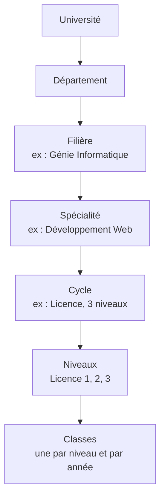

# Structure académique

**Menu :** Pédagogie → Structure Académique — **Accès :** domaine *Pédagogie* (Écriture pour modifier).

Cette page décrit l'organisation de l'établissement. Elle se remplit **une fois** à la mise en service, puis évolue peu. Elle comporte huit onglets.

## Fonctionnement commun à tous les onglets

1. Cliquez sur l'onglet voulu.
2. **Ajouter** ouvre le formulaire ; remplissez-le puis **Enregistrer** (ou **Annuler**). Les champs marqués d'un astérisque sont obligatoires.
3. Dans le tableau, l'icône crayon modifie une ligne, la corbeille la supprime (avec confirmation).

Les noms sont uniques dans leur parent, sans tenir compte des majuscules : deux départements « Informatique » et « informatique » dans la même université sont refusés (« Cette université a déjà un département de ce nom. »).

### Les modifications se répercutent automatiquement

| Vous modifiez… | SmartCampus met à jour… |
|---|---|
| Le nom d'une **spécialité** | les noms de ses classes (*Génie Logiciel Licence 1 (2026-2027)*…) |
| Le **type de cycle** d'une spécialité (Licence → BTS) | le cycle, les niveaux (*BTS 1, 2…*) et les classes |
| Le **nombre de niveaux** d'une spécialité | **plus grand** : ajoute les niveaux manquants et leurs classes pour chaque année ; **plus petit** : retire les derniers niveaux et leurs classes, **seulement s'ils sont vides** |
| La **filière** d'une spécialité | déplace ses cycles et ses classes (refusé si la spécialité a des inscrits) |
| Le nom d'une **filière** | les noms de ses classes sans spécialité |
| Le nom d'un **type de cycle** (*Système* → *Paramètres Globaux* → *Cycles Globaux*) | les cycles, niveaux et classes qui portent ce nom |

Une classe dont vous avez changé le nom à la main garde son nom.

!!! danger "Supprimer un élément de la structure"
    Supprimer un élément supprime aussi tout ce qui en dépend : une université emporte ses départements, filières, spécialités, niveaux et classes. Pour protéger les données, la suppression est **refusée** tant que l'élément ou ses descendants ont des étudiants, inscriptions, notes, paiements, frais, créneaux d'emploi du temps, épreuves, affectations, pré-inscriptions ou heures de vacataires. Le message indique ce qui reste (par exemple « La filière « Gestion » contient des données (12 étudiants, 3 frais de scolarité) »). Ne supprimez qu'un élément créé par erreur ; sinon, modifiez-le.

## Onglet *Universités*

L'établissement (ou les universités de tutelle). Champs : « Nom », « Code », « Description ».

## Onglet *Départements*

Regroupement de filières. Champs : « Nom du département », « Université », « Description ».

## Onglet *Filières*

La formation principale (par exemple *Génie Informatique*, *Gestion*).

| Champ | Exemple |
|---|---|
| Nom de la filière (ex: Génie Informatique) | Génie Informatique |
| Département | Sciences et Technologies |
| Nom du responsable | Dr Mbarga |

!!! info "Matricules"
    Les 4 premières lettres du nom de la filière forment le début du matricule des étudiants (`GÉNI-2026-0001`). Choisissez le nom avant d'inscrire des étudiants.

## Onglet *Spécialités*

Une option à l'intérieur d'une filière. **C'est ici que les niveaux et les classes sont générés automatiquement.**

| Champ | Exemple |
|---|---|
| Filière | Génie Informatique |
| Nom de la spécialité (ex: Développement Web) | Développement Web |
| Type de Cycle (ex: Licence, BTS, Master) | Licence |
| Nombre de niveaux (ex: 3 pour Licence 1, 2, 3) | 3 |

Résultat : les niveaux *Licence 1, 2, 3* et les classes *Développement Web Licence 1*, *Développement Web Licence 2*, *Développement Web Licence 3* sont créés pour chaque année académique.

**Modifier une spécialité** (crayon) : le formulaire affiche son type de cycle et son nombre de niveaux actuels. Changez-les puis **Enregistrer** : le message confirme le résultat (« Spécialité modifiée : BTS, 2 niveau(x). Niveaux et classes mis à jour. »). Pour retirer un niveau qui a des inscrits, le message indique ce qu'il contient : rien n'est modifié.

## Onglet *Niveaux*

Liste des niveaux (Licence 1, BTS 2…). Normalement générés par l'onglet Spécialités ; ajoutez un niveau ici seulement pour compléter un cycle existant (la classe correspondante sera créée automatiquement).

## Onglet *Classes*

Une classe = un niveau d'une spécialité pour une année académique. C'est l'unité utilisée partout : inscriptions, frais, emplois du temps, notes.

- Les classes sont normalement **créées automatiquement**.
- Vous pouvez en ajouter une à la main (par exemple un groupe B).

## Onglet *Années Académiques*

Le même écran est disponible dans le menu **Pédagogie** → **Années académiques**. Les rôles qui ont le droit **Gérer les années académiques** sans avoir la Pédagogie y accèdent par ce menu.

Le tableau liste les années (Libellé, Début, Fin, Statut **Active** ou **Archivée**). Avec le droit **Gérer les années académiques** :

| Action | Effet |
|---|---|
| **Nouvelle année** | Libellé (format AAAA-AAAA), début, fin, description. L'option « En faire l'année active maintenant » l'active aussitôt. Les classes de l'année précédente sont recopiées. |
| **Activer** | Fait de cette année l'année de travail de toute la plateforme ; l'année active précédente est **archivée**. |
| Crayon | Modifier le libellé, les dates ou la description. |
| Corbeille | Supprimer une année **archivée et vide** (sans inscriptions, notes, frais, créneaux ni épreuves). Sinon, un message indique ce qu'elle contient. |

L'année active ne peut être ni supprimée ni simplement désactivée : activez l'année qui la remplace.

Voir [Démarrer une nouvelle année](../demarrer-une-annee.md) et, pour l'accès aux années archivées, [Rôles et droits d'accès](../roles-et-acces.md#annees-academiques-et-archives).

## Onglet *Salles*

Les salles de cours, utilisées par l'emploi du temps (qui empêche de réserver une salle deux fois au même moment). Champs : « Nom de la salle », « Capacité (optionnel) ».
