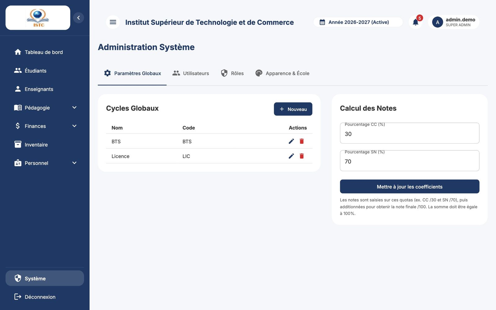
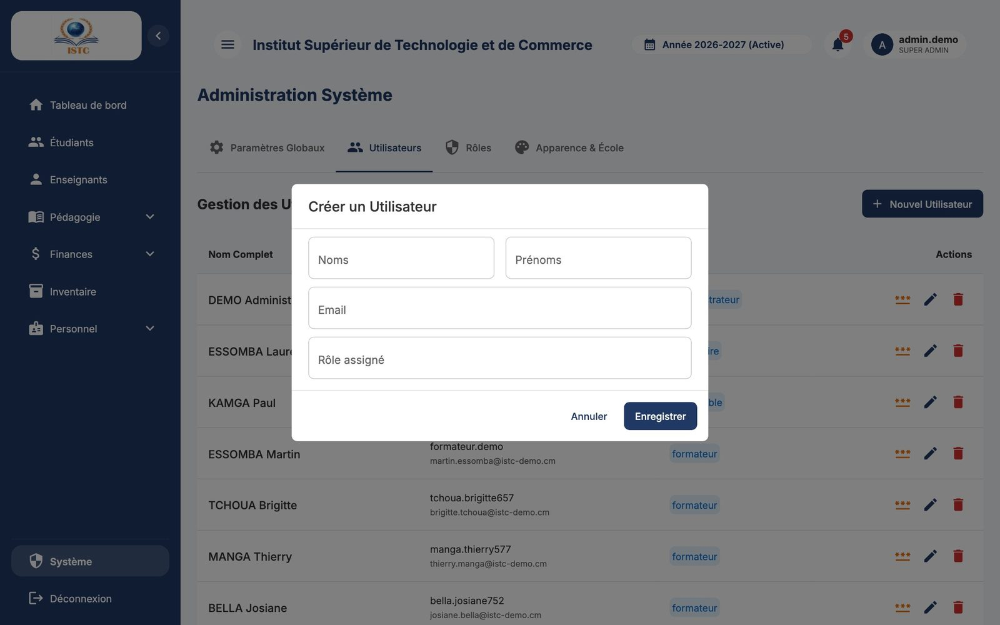
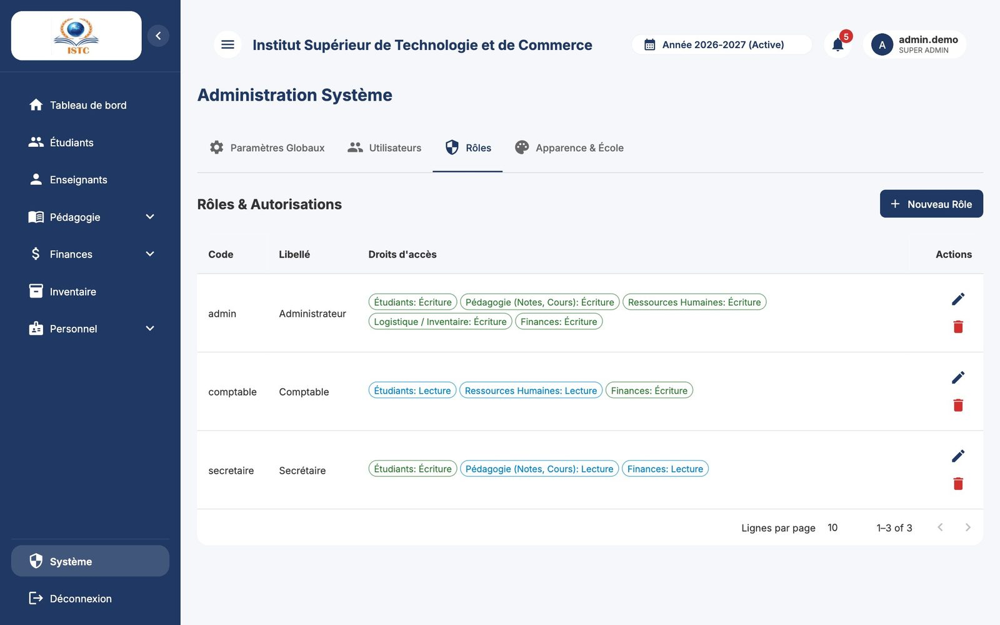
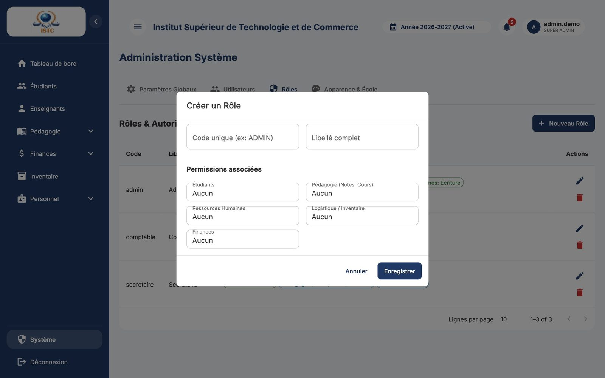

# Système (paramètres, utilisateurs, rôles, apparence)

**Menu :** Système — **Accès :** administrateurs uniquement (rôles `admin` / `superadmin`).

La page « Administration Système » comporte quatre onglets : *Paramètres Globaux*, *Utilisateurs*, *Rôles*, *Apparence & École*.

## Onglet *Paramètres Globaux*

### Cycles Globaux

Les types de cycles (Licence, BTS, Master…) et leurs **horaires**, utilisés par l'emploi du temps.

1. **Nouveau** (ou crayon pour modifier un cycle existant).
2. Remplissez « Nom du cycle (ex: Licence) », « Code (ex: LIC) », « Début Journée », « Fin Journée », « Début Pause », « Fin Pause ».
3. Enregistrez.

Par défaut : journée de **08:00 à 18:00**, pause de **12:00 à 13:00**. Aucun cours ne peut être programmé pendant la pause ni en dehors de la journée.

### Calcul des Notes

« Pourcentage CC (%) » et « Pourcentage SN (%) » (par défaut 30 / 70). La somme doit être égale à 100. Cliquez sur **Mettre à jour les coefficients**.

!!! warning "Effet sur les notes existantes"
    **Toutes** les notes déjà saisies, y compris celles des années précédentes, sont **converties** à la nouvelle échelle (une note CC de 15/30 devient 20/40 si le CC passe à 40 %). Le résultat final de chaque étudiant ne change pas, mais les relevés des anciennes années afficheront les nouvelles échelles. Faites ce réglage **une fois pour toutes**, avant les premières saisies.

## Onglet *Utilisateurs* — comptes du personnel

« Gestion des Utilisateurs » liste tous les comptes (Nom Complet, Username / Email, Rôle).

### Créer un compte

1. **Nouvel Utilisateur**.
2. Remplissez « Noms », « Prénoms », « Email » et le « Rôle assigné ».
3. **Enregistrer**.
4. La fenêtre « Accès Utilisateur » affiche le **nom d'utilisateur** (généré : `noms.prénoms` + 3 chiffres) et le **mot de passe temporaire**. Utilisez l'icône **Copier le mot de passe**, transmettez les identifiants, puis cliquez sur **J'ai compris**.

!!! warning
    Le mot de passe n'est affiché qu'une seule fois.

### Réinitialiser un mot de passe

Icône **Changer le mot de passe** sur la ligne : un nouveau mot de passe temporaire s'affiche.

### Modifier, désactiver, supprimer

Le crayon permet de changer le rôle ou les informations. La corbeille supprime le compte.

!!! note "Comptes formateurs et étudiants"
    Les comptes des formateurs se créent depuis **Enseignants** et ceux des étudiants automatiquement. Ne créez pas ici de compte avec le rôle *formateur* ou *étudiant* : il ne serait relié à aucun dossier.

## Onglet *Rôles* — créer un rôle {#creer-un-role}

« Rôles & Autorisations » liste les rôles (Code, Libellé, Droits d'accès).

1. **Nouveau Rôle**.
2. « Code unique (ex: ADMIN) » : un code court sans espace (ex. `secretaire`, `comptable`). Les codes `admin` et `superadmin` donnent accès à tout.
3. « Libellé complet » : le nom affiché (ex. « Secrétaire de direction »).
4. Pour chaque domaine — **Étudiants**, **Pédagogie (Notes, Cours)**, **Finances**, **Logistique / Inventaire**, **Ressources Humaines** — choisissez **Aucun**, **Lecture** ou **Écriture**.
5. **Enregistrer**.

Les droits sont expliqués dans [Rôles et droits d'accès](../roles-et-acces.md). Les personnes concernées doivent **se déconnecter puis se reconnecter** pour voir leurs nouveaux droits.

## Onglet *Apparence & École*

« Configuration de l'Établissement & Apparence Globale ». Ces données s'appliquent partout, **y compris sur les documents PDF générés** (relevés, certificats, cartes).

| Bloc | Champs |
|---|---|
| Identité visuelle | **Logo principal** (affiché dans le menu et sur la page de connexion), **Logo documents** (en-tête des relevés et certificats), « Couleur Primaire », « Couleur Secondaire », « Couleur Texte », « Typographie (CSS Font Family) » |
| Informations de contact | « Nom de l'établissement », « Téléphone », « Email », « Adresse », « Ville », « Site Web », « Slogan / Devise » |
| Direction | « Nom du Directeur », « Titre du Directeur », **Signature** (image affichée sur les documents) |

Cliquez sur **Enregistrer la configuration**. Rechargez la page pour voir les nouvelles couleurs.

!!! tip "Images"
    Utilisez des images PNG à fond transparent : logo d'environ 400 × 400 pixels, signature d'environ 600 × 200 pixels.
