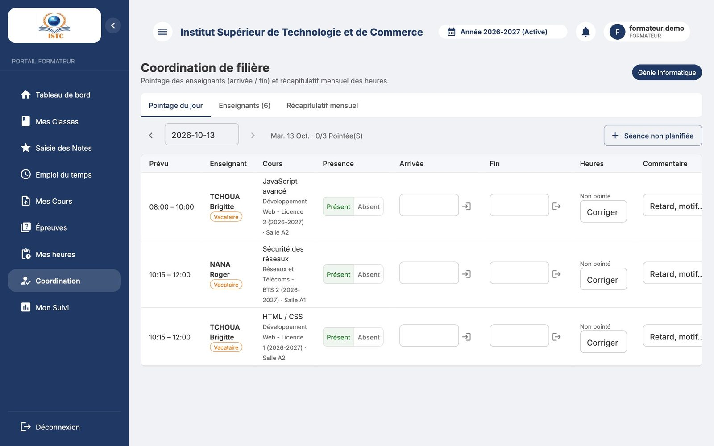
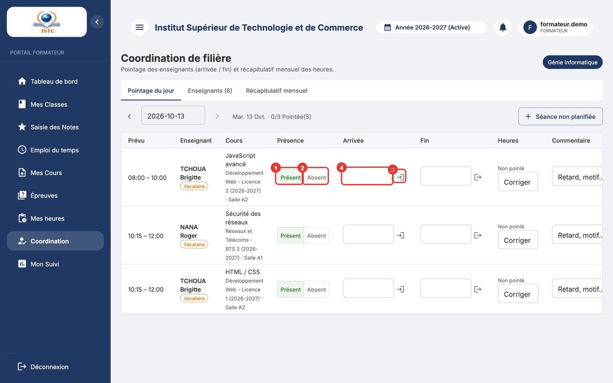
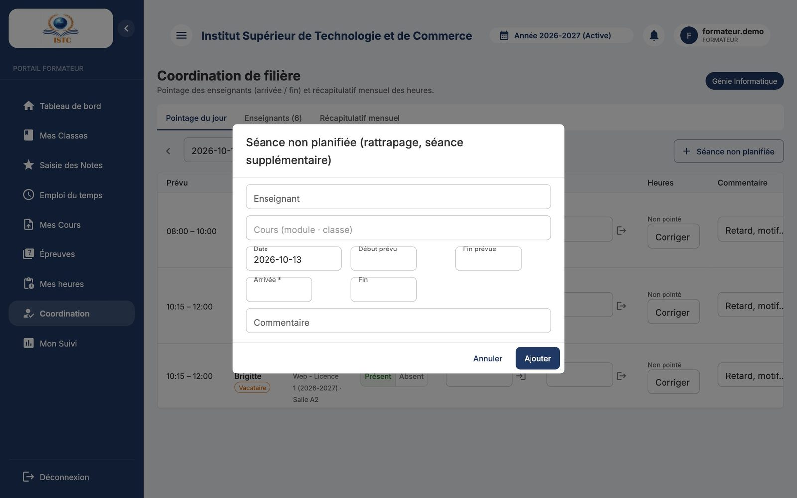

# Coordonnateur de filière

Cette page s'adresse aux **formateurs désignés coordonnateurs** d'une ou plusieurs filières (désignation faite par l'administration dans **Pédagogie** → **Coordonnateurs**).

Votre mission dans SmartCampus :

1. **chaque jour**, pointer l'arrivée et la fin des cours des enseignants de votre filière ;
2. **à la fin du mois**, vérifier et **clôturer** le récapitulatif de chaque enseignant pour l'envoyer à la finance.

## Ouvrir l'espace Coordination

Connectez-vous à votre portail formateur, puis cliquez sur **Coordination** dans le menu. Si le message « Vous n'êtes coordonnateur d'aucune filière. Contactez l'administration. » s'affiche, votre désignation n'a pas encore été faite (ou rechargez la page après la désignation).

La page « Coordination de filière » comporte trois onglets : *Pointage du jour*, *Enseignants* et *Récapitulatif mensuel*. La liste « Filière » en haut permet de choisir une filière, ou « Toutes mes filières ».

## Onglet *Pointage du jour*

Le tableau liste les **cours prévus à l'emploi du temps** à la date choisie, pour vos filières : enseignant, type (permanent / vacataire), cours (module · classe), horaire prévu.

### Pointer une séance

1. Vérifiez la « Date » (bouton **Aujourd'hui** pour revenir à la date du jour ; vous pouvez choisir une date passée pour rattraper un oubli).
2. Quand l'enseignant arrive, cliquez sur l'icône **Arrivé maintenant** : l'heure actuelle est inscrite dans « Arrivée ». Vous pouvez aussi taper l'heure vous-même (ex. `08:10`).
3. À la fin du cours, cliquez sur **Terminé maintenant** (ou tapez l'heure de fin).
4. Cliquez sur **Enregistrer** (icône disquette) sur la ligne.

La colonne « Présence » passe de *Non pointé* à *Présent*.

### Enseignant absent

Choisissez *Absent* dans la colonne « Présence » puis **Enregistrer**. Ajoutez au besoin un « Commentaire » (ex. « prévenu, cours reporté »). Une séance absente compte 0 heure.

### Séance non prévue (rattrapage, séance supplémentaire)

1. Cliquez sur **Séance non planifiée**.
2. Remplissez « Enseignant », « Cours (module · classe) », « Date », « Début prévu », « Fin prévue », « Arrivée * », « Fin » et éventuellement « Commentaire ».
3. Enregistrez. La séance est marquée « Hors planning » ; la finance la voit comme telle.

### Corriger ou supprimer un pointage

Modifiez les heures sur la ligne puis **Enregistrer**, ou cliquez sur **Supprimer le pointage**. Si l'icône indique « Récap du mois clôturé : rouvrez-le pour modifier », allez d'abord dans l'onglet *Récapitulatif mensuel* et cliquez sur **Rouvrir** (possible tant que la finance n'a pas validé).

## Onglet *Enseignants*

La liste des enseignants qui interviennent dans votre filière (affectés ou présents à l'emploi du temps de l'année) : contact, type, taux horaire, cours à assurer. Si elle est vide (« Aucun enseignant n'est affecté ou planifié dans cette filière pour l'année en cours. »), l'emploi du temps de la filière n'est pas encore saisi : prévenez l'administration.

## Onglet *Récapitulatif mensuel*

Pour le mois choisi, une ligne par enseignant : séances, absences, heures, montant (pour les vacataires) et statut.

- **Détail des pointages** : la liste complète des séances du mois pour vérification.
- **Clôturer** : envoie le récapitulatif à la finance et verrouille les pointages. Disponible à partir du **dernier jour du mois** (avant, le message « Le mois n'est pas terminé : les heures sont provisoires… » s'affiche).
- **Tout clôturer (n)** : clôture en une fois tous les récapitulatifs ouverts du mois (même condition de date).
- **Rouvrir** : déverrouille un récap clôturé pour corriger (tant qu'il n'est pas validé).
- Un récap **Rejeté** par la finance affiche le motif du rejet : corrigez les pointages concernés, puis **Clôturer** à nouveau.

!!! tip "Bonnes pratiques"
    - Pointez **le jour même** : c'est plus fiable que de reconstituer le mois de mémoire.
    - Clôturez **dans les 2-3 premiers jours du mois suivant** pour que les vacataires soient payés à temps.
    - Les heures sont arrondies au quart d'heure : inutile de pointer à la minute près.
