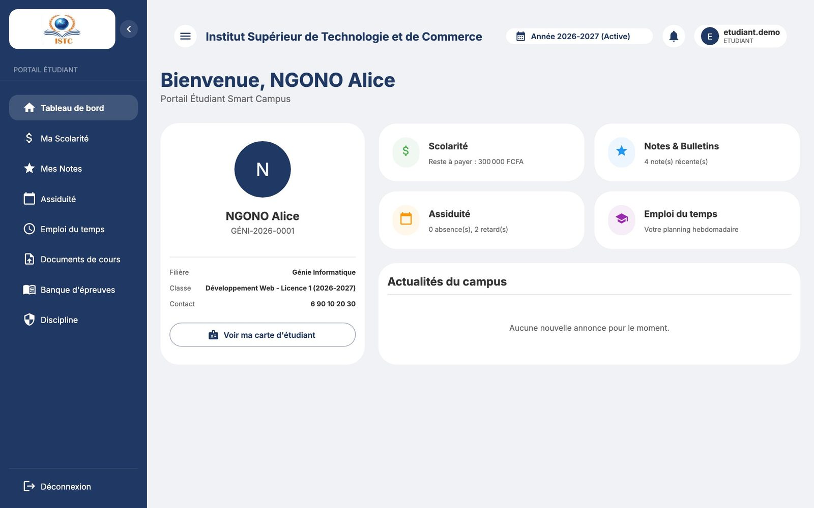
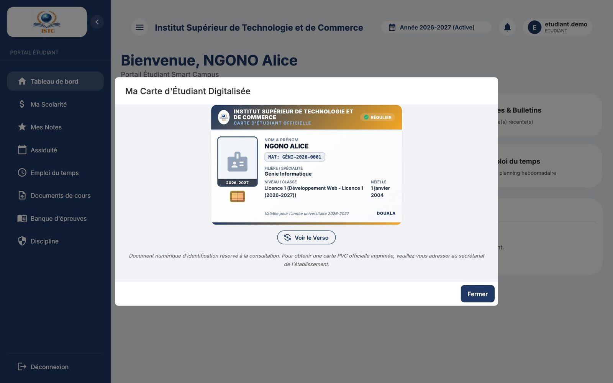
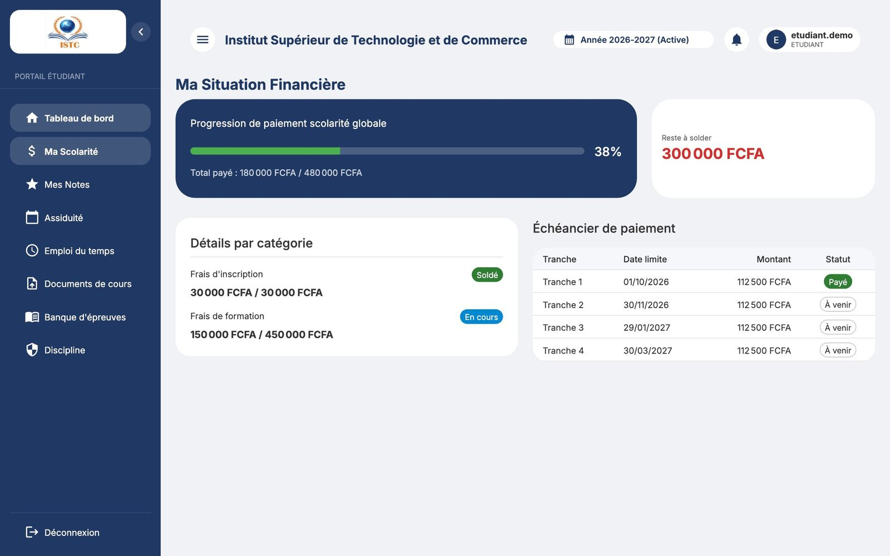
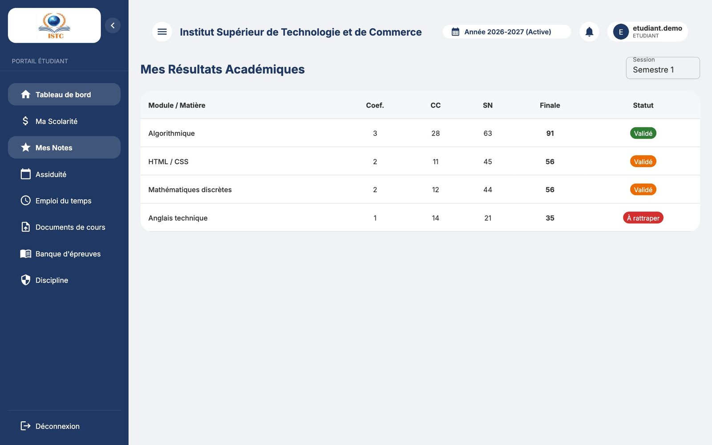
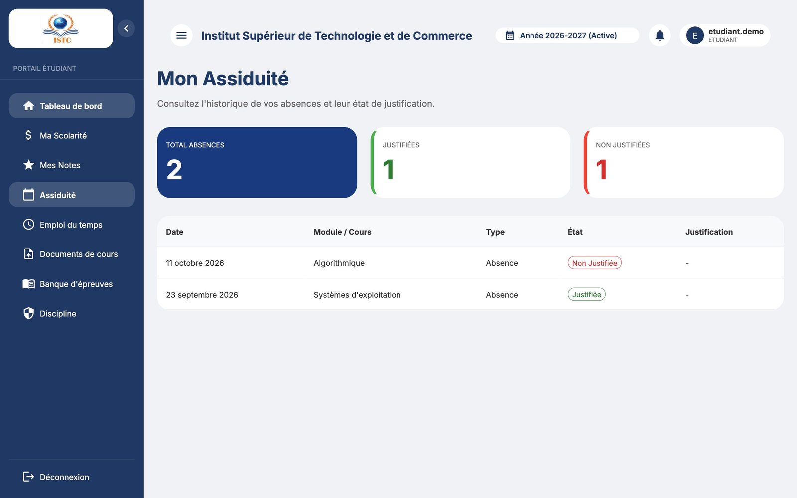
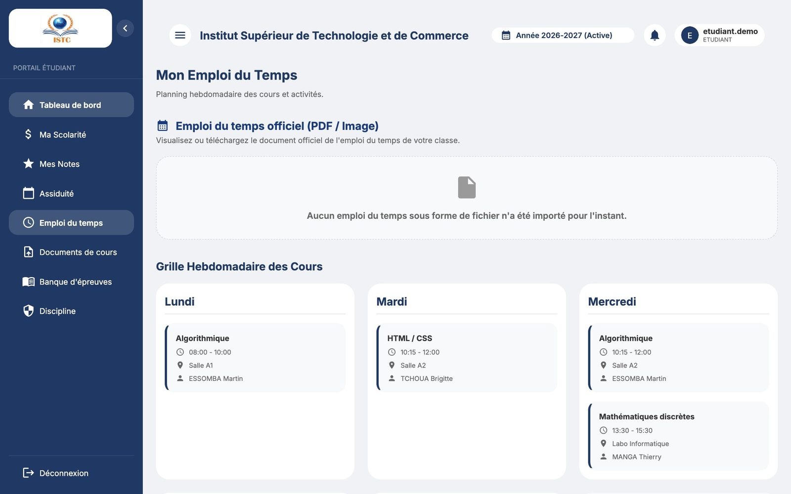
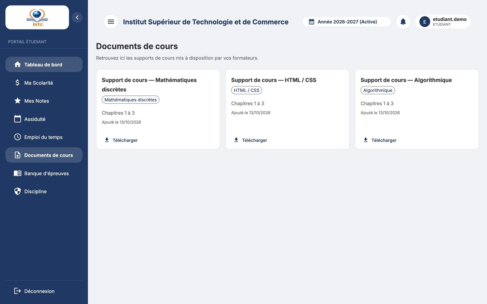
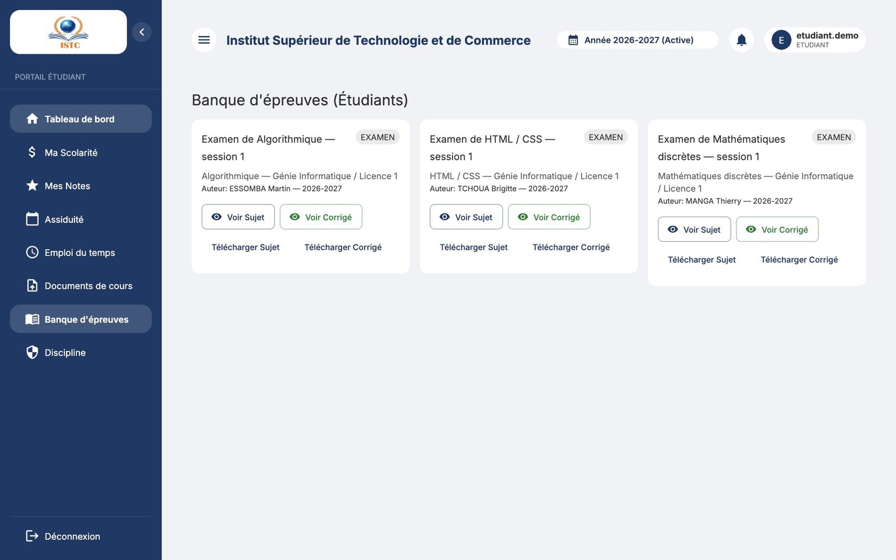
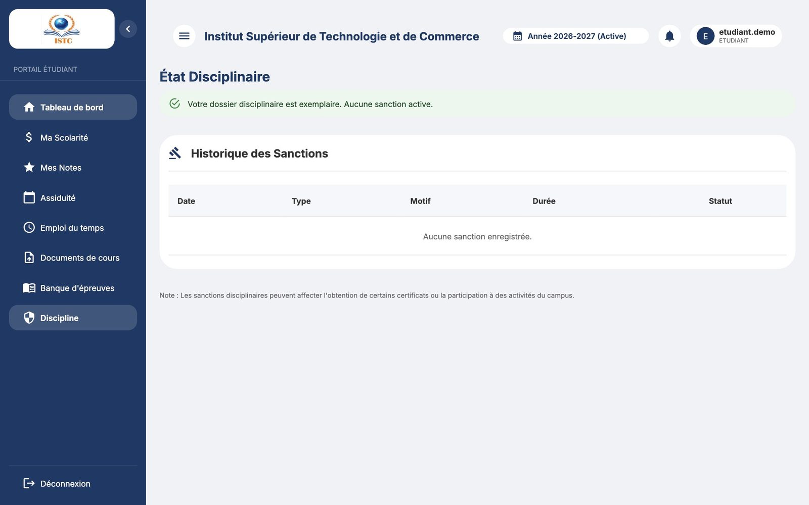

# Portail étudiant

Le portail étudiant permet de suivre sa scolarité **depuis un ordinateur ou un téléphone**. Les identifiants (nom d'utilisateur et mot de passe initial) sont remis par l'administration après l'inscription.

Menu : **Tableau de bord**, **Ma Scolarité**, **Mes Notes**, **Assiduité**, **Emploi du temps**, **Documents de cours**, **Banque d'épreuves**, **Discipline**.

## Tableau de bord

- Message « Bienvenue, *votre nom* » avec votre classe et votre matricule.
- **Voir ma carte d'étudiant** : affiche votre carte (recto / verso).
- **Actualités du campus**.

Si le message « Impossible de charger votre profil. » s'affiche, cliquez sur **Réessayer** ; si le problème persiste, contactez l'administration (votre inscription n'est peut-être pas finalisée pour l'année en cours).

## Ma Scolarité

« Ma Situation Financière » :

- le montant **dû**, **payé** et **restant** pour l'inscription et pour la formation (« Détails par catégorie ») ;
- l'« Échéancier de paiement » : chaque tranche, sa date limite, son montant et son statut (**Payé**, **Partiel**, **Retard** ou **À venir**).

Les réductions et bourses accordées sont déjà déduites. Pour toute question sur un paiement, munissez-vous de votre reçu et adressez-vous au service de scolarité.

## Mes Notes

« Mes Résultats Académiques » : choisissez la « Session » (Semestre 1, Semestre 2). Pour chaque cours : Coef., **CC**, **SN** (examen), note **Finale** et Statut.

!!! info "Pourquoi une note n'apparaît-elle pas ?"
    Une note n'est affichée qu'après **validation par l'administration**. Si un formateur vous a annoncé une note qui n'apparaît pas encore, elle est en cours de vérification.

## Assiduité

« Mon Assiduité » : vos absences et retards (Date, Module / Cours, Type, État, Justification). Apportez vos justificatifs à l'administration pour qu'une absence soit notée « justifiée ».

## Emploi du temps

« Mon Emploi du Temps » : la « Grille Hebdomadaire des Cours » de votre classe, et le document officiel (PDF / image) s'il a été publié, à visualiser ou télécharger.

## Documents de cours

Les supports partagés par vos formateurs : bouton **Télécharger**.

## Banque d'épreuves

Les anciens sujets publiés : **Voir Sujet**, **Voir Corrigé**, **Télécharger Sujet**, **Télécharger Corrigé**.

## Discipline

« État Disciplinaire » : vos éventuelles sanctions (Date, Type, Motif, Durée, Statut). « Votre dossier disciplinaire est exemplaire. Aucune sanction active. » s'affiche s'il n'y en a pas.

## Se déconnecter

Avatar en haut à droite → **Déconnexion**. Pensez-y sur un ordinateur partagé (cybercafé, salle informatique).
