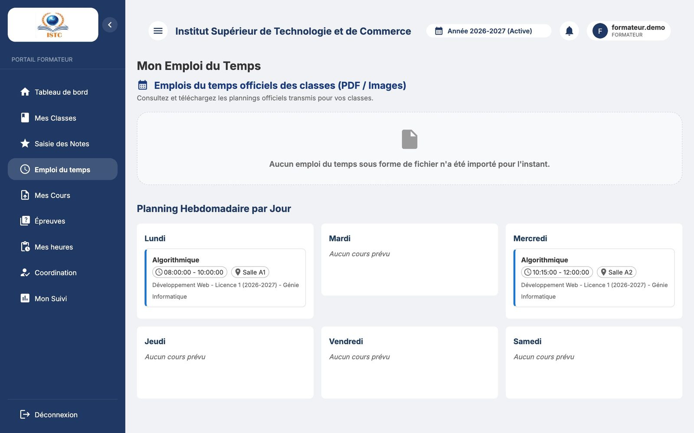
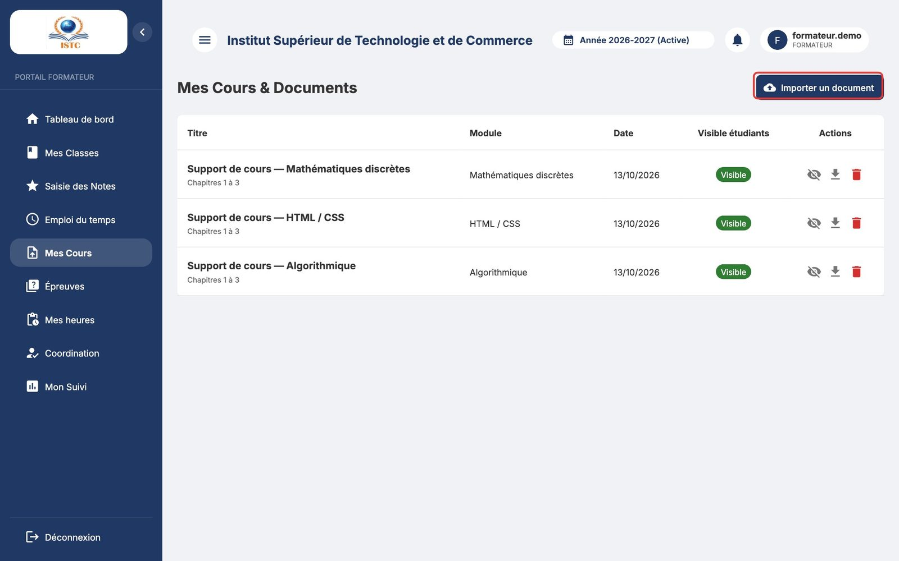
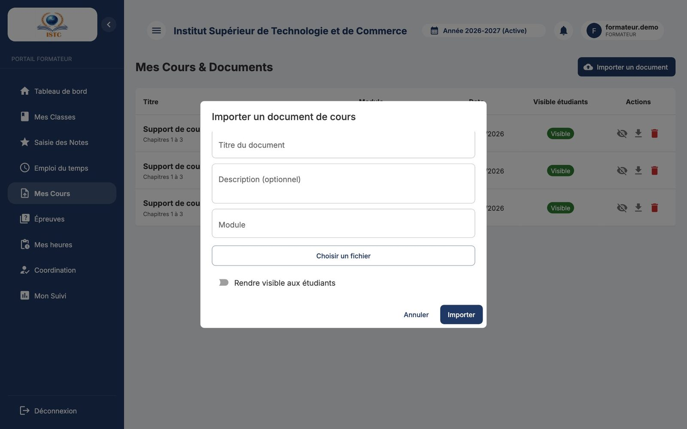
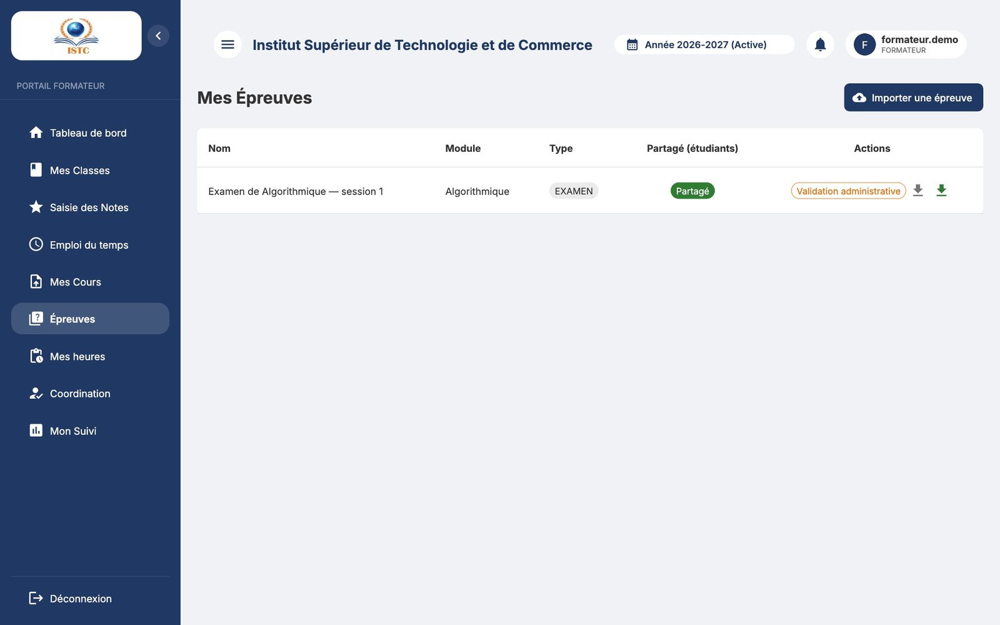
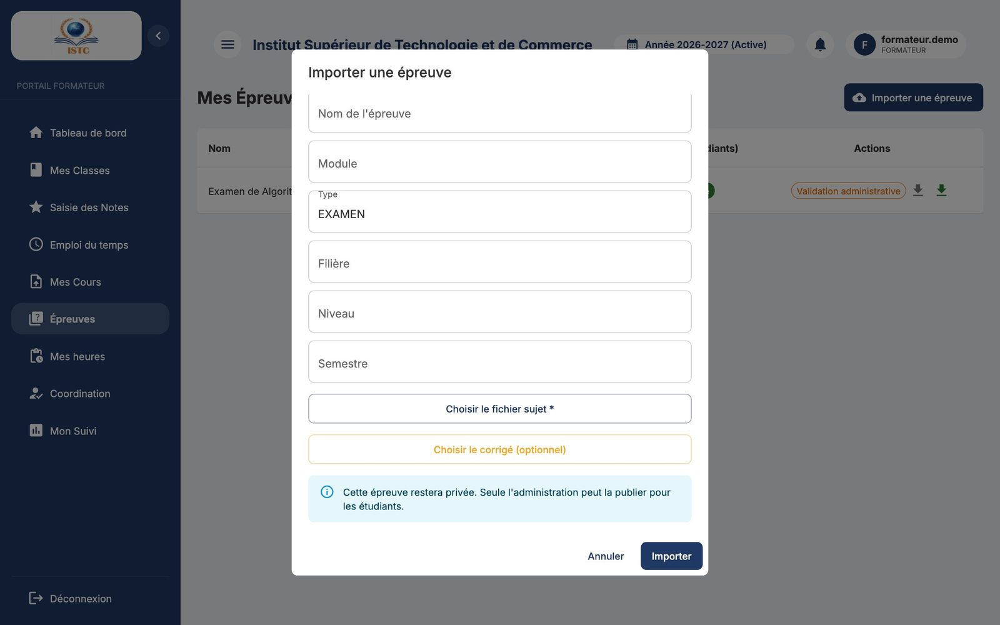
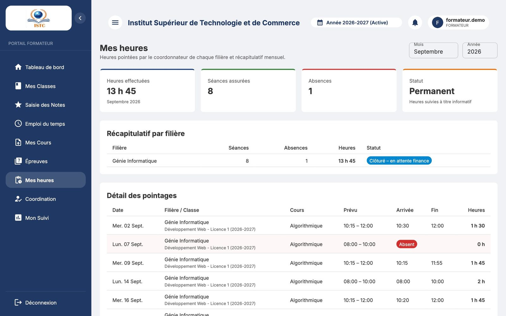

# Portail formateur

Le portail formateur est votre espace personnel d'enseignant. Vous y accédez avec les identifiants remis par l'administration (voir [Premiers pas](premiers-pas.md#se-connecter)).

Menu : **Tableau de bord**, **Mes Classes**, **Saisie des Notes**, **Emploi du temps**, **Mes Cours**, **Épreuves**, **Mes heures**, **Mon Suivi**, et **Coordination** si vous êtes coordonnateur de filière.

!!! info "Vous ne voyez rien ?"
    Vos classes et cours proviennent de l'**emploi du temps** saisi par l'administration (ou, à défaut, des cours indiqués dans votre fiche). Si « Aucune affectation trouvée pour cette année académique. » s'affiche, contactez l'administration.

## Tableau de bord

- Vos chiffres clés : nombre de classes, d'étudiants…
- **Prochaines Séances** : Jour, Horaire, Module, Classe, Salle.
- **Mes Classes** : accès rapide.

## Mes Classes

« Mes Classes & Étudiants » : pour chaque classe et cours qui vous est attribué, la liste des étudiants inscrits (Matricule, Nom complet, Email).

## Saisie des Notes

1. Choisissez la « Classe » puis le « Module ».
2. La liste des étudiants apparaît avec trois colonnes : **CC (/30)**, **Examen (/70)** et **Rattrapage (/70)** (les maxima suivent le réglage de l'établissement).
3. Tapez les notes. Les décimales au quart de point sont acceptées (`12.25`, `12.5`, `12.75`). Laissez vide une note non encore connue.
4. Cliquez sur **Enregistrer les notes**.

!!! warning "Vos notes ne sont pas encore visibles par les étudiants"
    Elles doivent d'abord être **validées par l'administration**. Toute modification d'une note déjà validée la masque de nouveau aux étudiants jusqu'à la prochaine validation. Prévenez l'administration lorsque vos saisies sont terminées.

La **note de rattrapage remplace la note d'examen** dans le calcul. Note finale (sur 100) = CC + Examen (ou CC + Rattrapage).

## Emploi du temps

« Mon Emploi du Temps » : votre « Planning Hebdomadaire par Jour ». La rubrique « Emplois du temps officiels des classes (PDF / Images) » permet de consulter et télécharger les plannings officiels transmis pour vos classes.

## Mes Cours (documents de cours)

Partagez vos supports (cours, TD, exercices) avec vos étudiants.

1. **Importer un document**.
2. Remplissez « Titre du document », « Description (optionnel) », choisissez le « Module » et le fichier (PDF, image…).
3. Cochez **Rendre visible aux étudiants** pour qu'ils le voient immédiatement (sinon, il reste privé).
4. **Importer**.

Chaque document peut être **Téléchargé** ou **Supprimé**. Les étudiants le retrouvent dans « Documents de cours ».

## Épreuves

Déposez vos sujets d'examen et corrigés dans la banque d'épreuves.

1. **Importer une épreuve**.
2. Remplissez « Nom de l'épreuve », « Module », « Type », « Filière », « Niveau », « Semestre », puis joignez le sujet et le corrigé.
3. Cochez éventuellement **Partager immédiatement aux étudiants**. Sinon : « Cette épreuve restera privée. Seule l'administration peut la publier pour les étudiants. »
4. **Importer**.

La colonne « Validation administrative » indique si l'épreuve est publiée.

## Mes heures

Le suivi de vos heures pointées par le coordonnateur de chaque filière :

| Indicateur | Signification |
|---|---|
| Heures effectuées | Total des heures retenues du mois (arrondies au quart d'heure). |
| Séances assurées | Nombre de séances où vous étiez présent. |
| Absences | Séances prévues non assurées. |
| Montant estimé | Heures × votre taux horaire (vacataires). Devient définitif après validation par la finance. |
| Statut | Ouvert → Clôturé (par le coordonnateur) → Validé (par la finance) → Payé ; ou Rejeté (correction en cours). |

- **Récapitulatif par filière** : le détail par filière.
- **Détail des pointages** : chaque séance (Date, Cours, Prévu, Arrivée, Fin, Heures) ; les mentions « Hors planning » (séance ajoutée) et « Absent » apparaissent.
- **Historique** : les mois précédents (Mois, Filière, Heures, Montant, Statut).

!!! tip "Une erreur dans vos heures ?"
    Signalez-la à votre **coordonnateur** avant la fin du mois : il peut corriger tant que le récapitulatif n'est pas validé par la finance.

## Mon Suivi

Statistiques de votre activité : effectifs par classe, répartition de vos séances par jour.

## Coordination

Réservé aux coordonnateurs de filière : voir [Coordonnateur de filière](coordonnateur.md).
