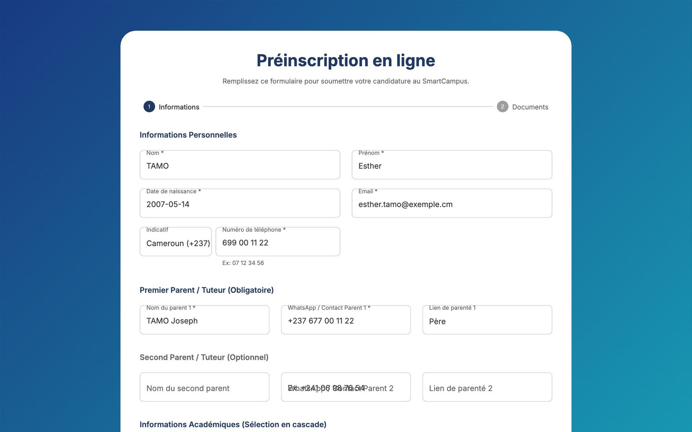
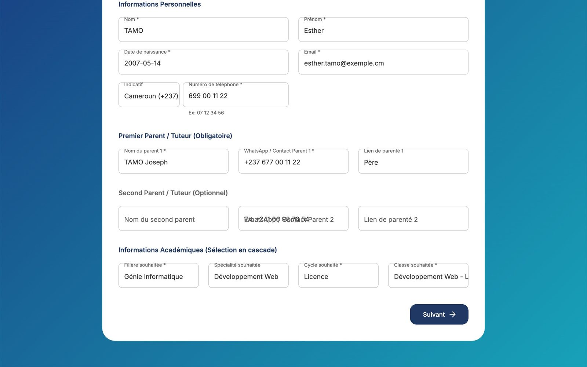
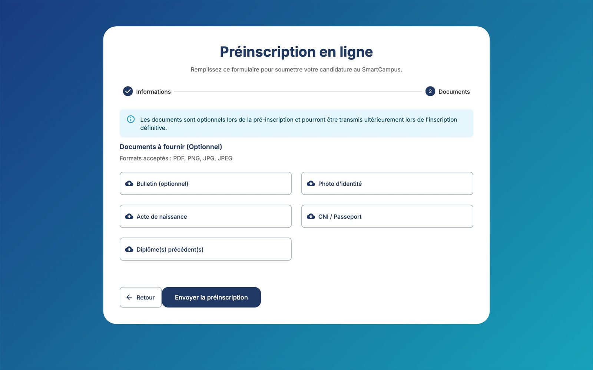

# Préinscription en ligne (candidats)

Cette page s'adresse aux **futurs étudiants** (ou à leurs parents). Elle ne nécessite **aucun compte**.

## Accéder au formulaire

1. Ouvrez l'adresse de la plateforme (par exemple `https://istc.tenteeglobal.com`).
2. Sur la page de connexion, cliquez sur le bouton **Préinscription en ligne**.
3. Le formulaire « Préinscription en ligne » s'ouvre. Il comporte **deux étapes** : *Informations* puis *Documents*.

## Étape 1 — Informations

Remplissez les champs. Ceux marqués d'un astérisque `*` sont obligatoires.

| Champ | Exemple | Conseil |
|---|---|---|
| Nom * | NGONO | Comme sur l'acte de naissance. |
| Prénom * | Alice | |
| Date de naissance * | 12/04/2005 | Utilisez le calendrier. |
| Email * | alice@exemple.cm | Une adresse que vous consultez : l'établissement vous contactera par ce biais. |
| Indicatif | Cameroun (+237) | Choisissez votre pays : la liste est réglée par défaut sur un autre pays. |
| Numéro de téléphone * | 699112233 | Sans l'indicatif ni espaces. |
| Nom du parent 1 * | NGONO Paul | Parent ou tuteur. |
| WhatsApp / Contact Parent 1 * | 677000000 | Numéro WhatsApp de préférence (l'établissement peut y envoyer des notifications d'absence). |
| Lien de parenté 1 | Père | |
| Nom du second parent, WhatsApp / Contact Parent 2, Lien de parenté 2 | | Facultatif. |
| Filière souhaitée * | Génie Informatique | La liste propose les filières ouvertes. |
| Spécialité souhaitée | Développement Web | Selon la filière. |
| Cycle souhaité * | Licence | |
| Classe souhaitée * | Développement Web Licence 1 | |

Cliquez sur **Suivant**.

## Étape 2 — Documents

Vous pouvez joindre :

- le dernier bulletin ;
- une photo d'identité ;
- l'acte de naissance ;
- la CNI ou le passeport ;
- les diplômes précédents (plusieurs fichiers possibles).

Cliquez sur chaque zone pour choisir le fichier sur votre ordinateur ou téléphone.

!!! info "Les documents sont facultatifs"
    Ils pourront être transmis plus tard, lors de l'inscription définitive. Formats acceptés : **PDF, JPG, PNG**. Les autres types de fichiers sont refusés.

Validez ensuite le contrôle « Je ne suis pas un robot » s'il est affiché, puis envoyez le formulaire. Le bouton **Retour** permet de revenir à l'étape 1 sans perdre la saisie.

## Après l'envoi

Le message **« Pré-inscription envoyée »** confirme la réception. Cliquez sur **Retour à l'accueil**.

L'établissement étudie votre dossier et vous recontacte. Si la préinscription est approuvée :

- vous devenez étudiant de l'établissement, avec un **matricule** (par exemple `GÉNI-2026-0001`) ;
- un **compte pour le portail étudiant** est créé ; l'administration vous remet votre nom d'utilisateur et votre mot de passe initial.

## Erreurs possibles

| Message | Explication |
|---|---|
| Une pré-inscription avec cet email (ou ce numéro de téléphone) est déjà en cours de traitement | Vous avez déjà envoyé une demande : inutile de recommencer, l'établissement la traite. Contactez-le en cas de doute. |
| Un étudiant avec cet email est déjà inscrit | Cette adresse appartient déjà à un étudiant de l'établissement. |
| Type de fichier non autorisé | Le document n'est pas un PDF ou une image. Convertissez-le (par exemple en photographiant le document). |
| Champ obligatoire | Un champ marqué `*` est vide. |
| Vérification reCAPTCHA échouée | Cochez à nouveau « Je ne suis pas un robot », ou rechargez la page. |
