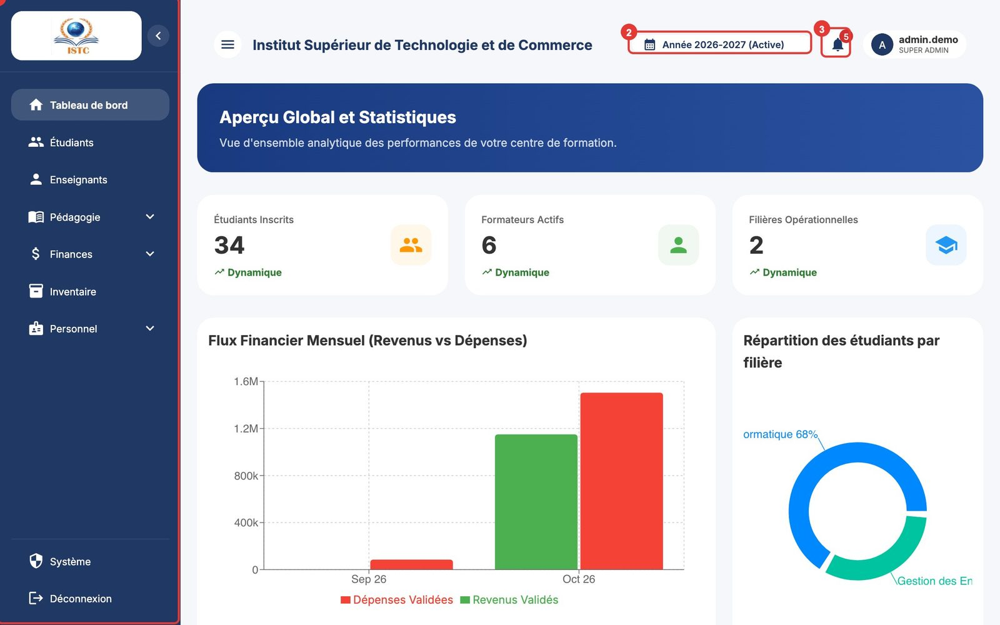

# Premiers pas

## Ouvrir la plateforme

1. Ouvrez votre navigateur (Google Chrome, Microsoft Edge, Mozilla Firefox ou Safari, dans une version récente).
2. Tapez l'adresse communiquée par l'établissement dans la barre d'adresse (par exemple `https://istc.tenteeglobal.com`) puis appuyez sur ++enter++.
3. La page de connexion **SMART CAMPUS** s'affiche, avec le message « Bienvenue ».

!!! tip "Ajoutez la page à vos favoris"
    Dans Chrome : cliquez sur l'étoile ☆ à droite de la barre d'adresse. Sur téléphone : menu du navigateur → « Ajouter à l'écran d'accueil ».

## Se connecter

1. Dans le champ « Nom d'utilisateur », tapez l'identifiant qui vous a été remis (par exemple `ngono.alice482`). Respectez les minuscules et les points.
2. Dans le champ « Mot de passe », tapez votre mot de passe. Les caractères sont masqués ; vérifiez la touche ++caps-lock++ (majuscules).
3. Si une case « Je ne suis pas un robot » (reCAPTCHA) est affichée, cochez-la et répondez éventuellement à l'image proposée.
4. Cliquez sur le bouton de connexion.

Selon votre type de compte, vous arrivez automatiquement :

| Type de compte | Page d'arrivée |
|---|---|
| Personnel administratif (admin, secrétariat, finance…) | **Tableau de bord** de l'administration |
| Formateur | **Portail formateur** (Tableau de bord du formateur) |
| Étudiant | **Portail étudiant** (« Bienvenue, *votre nom* ») |

### Qui me donne mes identifiants ?

| Vous êtes | Vos identifiants sont créés par | Où l'administration les trouve |
|---|---|---|
| Personnel | L'administrateur, dans **Système** → onglet *Utilisateurs* | Fenêtre « Accès Utilisateur » affichée à la création |
| Formateur | L'administration, dans **Enseignants** → bouton **Générer un compte portail** | Fenêtre « Identifiants du formateur » |
| Étudiant | Automatiquement, à l'approbation de la préinscription ou à l'ajout de l'étudiant | **Étudiants** → icône « Voir détails » → rubrique *Accès Portail Étudiant* |

### Messages d'erreur à la connexion

| Message / situation | Cause | Que faire |
|---|---|---|
| Identifiants incorrects | Nom d'utilisateur ou mot de passe erroné | Vérifiez la saisie (majuscules, espaces). Après plusieurs échecs, demandez une réinitialisation. |
| Compte désactivé | L'administration a désactivé le compte | Contactez l'administration. |
| Veuillez valider le reCAPTCHA / reCAPTCHA invalide ou expiré | La case « Je ne suis pas un robot » n'a pas été cochée ou a expiré (au bout de 2 minutes) | Rechargez la page (++f5++) et recommencez. |
| Vérification reCAPTCHA indisponible, réessayez | Le serveur n'arrive pas à joindre Google | Réessayez ; si cela dure, prévenez le responsable informatique. |
| La page tourne sans fin | Connexion internet coupée ou serveur indisponible | Vérifiez votre connexion, rechargez la page. Si le problème persiste, prévenez le responsable informatique. |

### J'ai oublié mon mot de passe

Le lien « Mot de passe oublié ? » de la page de connexion n'envoie pas encore d'email de réinitialisation. Demandez à l'administration :

- **Personnel** : **Système** → *Utilisateurs* → icône « Changer le mot de passe » sur votre ligne ; un mot de passe temporaire s'affiche, avec un bouton pour le copier.
- **Formateur** : **Enseignants** → détails du formateur → **Réinitialiser le mot de passe**.

!!! warning "Un mot de passe temporaire n'est affiché qu'une seule fois"
    Notez-le ou transmettez-le immédiatement à la personne concernée.

## Se repérer dans l'écran

L'écran est composé de trois zones :

1. **Le menu de gauche** : la liste des modules auxquels vous avez accès. Sur téléphone, il est caché ; touchez l'icône ☰ (« Menu principal ») en haut à gauche pour l'ouvrir. Les menus avec une flèche (par exemple *Pédagogie*, *Finances*, *Personnel*) se déplient en sous-menus.
2. **La barre du haut** :
    - le **sélecteur d'année académique** (« Année 2025-2026 (Active) ») ;
    - la cloche des **notifications** ;
    - votre **avatar** : il affiche votre nom d'utilisateur et votre rôle, et donne accès à **Déconnexion**.
3. **La zone centrale** : la page en cours (tableaux, onglets, boutons d'action).

### Les éléments que vous retrouverez partout

| Élément | Rôle |
|---|---|
| Bouton bleu en haut à droite (ex. **Ajouter un étudiant**, **Nouveau cours**) | Créer un nouvel élément. Ouvre un formulaire. |
| Icône crayon ✏️ « Modifier » | Modifier la ligne. |
| Icône corbeille 🗑️ « Supprimer » | Supprimer. Une fenêtre « Confirmer la suppression » demande toujours une confirmation. |
| Icône œil 👁️ « Voir détails » | Ouvrir la fiche complète (panneau latéral). |
| Bouton **Import / Export** | Importer une liste depuis Excel ou exporter le tableau. |
| Bouton **Exporter (Excel)** / **Télécharger PDF** | Télécharger un fichier. |
| Petit message coloré en bas de l'écran | Confirmation (vert) ou erreur (rouge) de la dernière action. Lisez-le : il explique la raison d'un refus. |
| Onglets en haut de page | Changer de rubrique sans quitter la page. |

## Choisir l'année académique

Toutes les données (classes, inscriptions, notes, emplois du temps, paiements) sont rangées **par année académique**.

1. Cliquez sur le sélecteur « Année … » dans la barre du haut.
2. Choisissez l'année. La mention **(Active)** indique l'année en cours.
3. La page se recharge avec les données de cette année.

!!! warning "Années archivées"
    Seule l'année **active** est accessible aux utilisateurs ordinaires. Les années précédentes (archives) ne sont consultables que par un **super-administrateur**. Si vous voyez des pages vides ou un message de refus après avoir changé d'année, revenez sur l'année *(Active)*.

## Se déconnecter

1. Cliquez sur votre avatar en haut à droite.
2. Cliquez sur **Déconnexion** (en rouge).

Déconnectez-vous toujours sur un ordinateur partagé. Par sécurité, la session expire aussi d'elle-même : après une longue inactivité (environ une journée), la plateforme vous renvoie vers la page de connexion.

## Version et nouveautés

Le numéro de la version installée est affiché tout en bas du menu de gauche (par exemple « Version 0.2.0 · 24/10/2026 »). Une **pastille orange** signale une nouvelle version que vous n'avez pas encore consultée.

Cliquez sur ce numéro pour ouvrir la fenêtre **Nouveautés**. Elle liste les nouveautés et corrections de chaque version, de la plus récente à la plus ancienne. Indiquez ce numéro quand vous signalez un problème à l'administration.

## Importer une liste depuis Excel (Import / Export)

Les pages Enseignants, Personnel, Inventaire et Emploi du temps proposent un bouton **Import / Export** pour éviter la saisie ligne par ligne.

1. Cliquez sur **Import / Export**.
2. Cliquez sur **Télécharger modèle** : un fichier avec les bonnes colonnes est téléchargé.
3. Ouvrez-le dans Excel (ou LibreOffice), remplissez **une ligne par élément** sans modifier la ligne d'en-tête, puis enregistrez (formats acceptés : `.xlsx`, `.xls`, `.csv`).
4. Revenez dans la fenêtre et choisissez le fichier avec le bouton de sélection de fichier. L'import démarre aussitôt.
5. Lisez le résultat :
    - « Import terminé » : tout a été importé ;
    - « Import terminé avec erreurs » : la liste « Erreurs » indique, pour chaque ligne refusée, son numéro (« Ligne 5 : … ») et la raison. Corrigez ces lignes dans le fichier et réimportez **uniquement** celles-ci, pour ne pas créer de doublons.

**Exporter CSV** télécharge le contenu actuel du tableau.

## Bonnes pratiques

- Ne partagez jamais votre mot de passe ; chaque action est faite sous votre nom.
- N'utilisez pas le bouton « Précédent » du navigateur pendant l'enregistrement d'un formulaire.
- Si une page paraît bloquée, rechargez-la avec ++f5++ (ou ++ctrl+r++, ++cmd+r++ sur Mac).
- Les fichiers à joindre (photos, actes, documents de cours) doivent être des **PDF ou images** (JPG, PNG). Les fichiers exécutables sont refusés.
