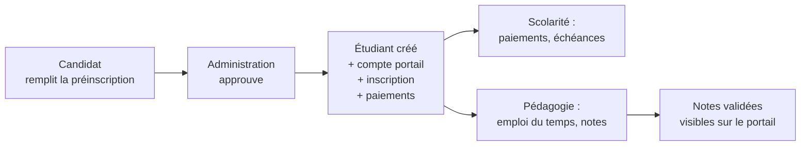
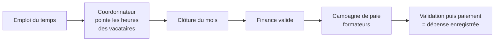

# SmartCampus ISTC

**SmartCampus** est la plateforme de gestion de l'établissement : préinscriptions en ligne, dossiers étudiants, structure académique, emplois du temps, notes et relevés, scolarité et paiements, paie du personnel et des formateurs, heures des vacataires, inventaire, congés…

Elle s'utilise dans un **navigateur internet** (Chrome, Edge, Firefox, Safari), sur ordinateur, tablette ou téléphone. Il n'y a rien à installer pour les utilisateurs.

!!! info "Version Word"
    Toute cette documentation existe aussi en un seul fichier Word : [SmartCampus_ISTC_Documentation_complete.docx](SmartCampus_ISTC_Documentation_complete.docx) (régénéré avec `outils/doc-word/construire.sh`).

## Qui fait quoi ?

| Vous êtes… | Vous utilisez… | Commencez par |
|---|---|---|
| **Un candidat** qui souhaite s'inscrire | Le formulaire public de préinscription | [Préinscription en ligne](guide/preinscription-candidat.md) |
| **Membre de l'administration** (direction, secrétariat, scolarité, comptabilité, RH, logistique) | L'espace d'administration | [Premiers pas](guide/premiers-pas.md) puis [Administration](guide/administration/index.md) |
| **Formateur / enseignant** | Le portail formateur | [Portail formateur](guide/portail-formateur.md) |
| **Coordonnateur de filière** (un formateur désigné) | Le menu « Coordination » du portail formateur | [Coordonnateur de filière](guide/coordonnateur.md) |
| **Étudiant** | Le portail étudiant | [Portail étudiant](guide/portail-etudiant.md) |
| **Responsable informatique** chargé d'installer la plateforme | Le serveur | [Installation et configuration](installation/index.md) |
| **Développeur** | Le code source | [Développeurs](developpeurs/index.md) |

## Les grands parcours en un coup d'œil

!!! tip "Conseil de lecture"
    Chaque page du guide suit le même plan : **à quoi sert l'écran**, **qui peut l'utiliser**, puis **des procédures pas à pas** avec les noms exacts des boutons tels qu'ils apparaissent à l'écran (en **gras**). Les encadrés « Attention » signalent les actions irréversibles.
