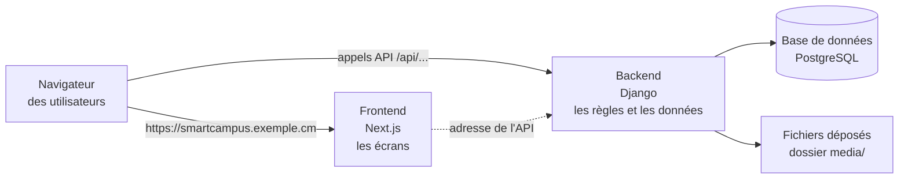

# Installation et configuration

Cette partie s'adresse à la personne chargée de **mettre en place** SmartCampus (responsable informatique, prestataire). Elle explique chaque étape commande par commande ; il suffit de savoir copier-coller dans un terminal.

## Comment la plateforme est construite

SmartCampus comporte **deux programmes** qui fonctionnent ensemble :

| Élément | Dossier | Rôle |
|---|---|---|
| **Backend** (API) | `back-istc/` | Calculs, droits d'accès, base de données, fichiers. Écrit en Python / Django. |
| **Frontend** (interface) | `frontend/` | Les pages affichées dans le navigateur. Écrit en JavaScript / Next.js. |
| **Base de données** | — | PostgreSQL en production (SQLite pour un essai sur un poste). |
| **Documentation** | `docs/` | Ce site (généré avec MkDocs). |

## Parcours conseillé

1. [Prérequis](prerequis.md) : ce qu'il faut avoir avant de commencer.
2. [Installation sur un poste (test)](installation-locale.md) : pour essayer la plateforme ou former les utilisateurs.
3. [Mise en ligne sur un serveur](deploiement-serveur.md) : l'installation définitive.
4. [Fichier de configuration (.env)](configuration.md) : la liste de tous les réglages.
5. [Sauvegardes et restauration](sauvegardes.md) : **à mettre en place dès le premier jour**.
6. [Mettre à jour la plateforme](mise-a-jour.md).
7. [Dépannage](depannage.md) : les erreurs courantes et leurs solutions.
